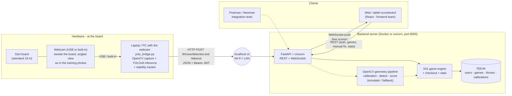
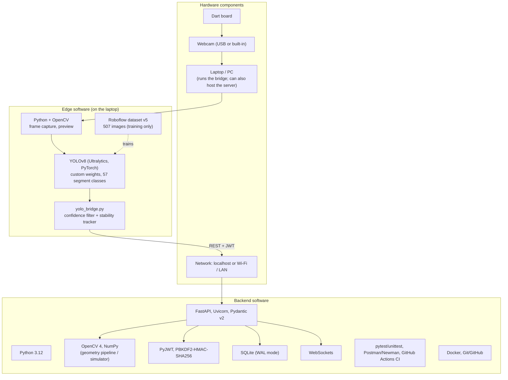
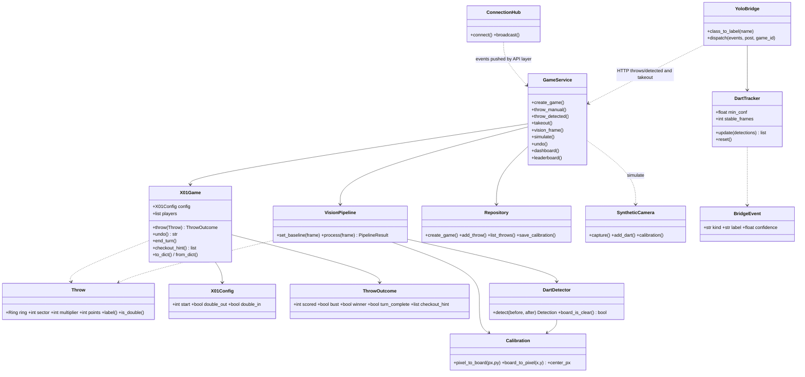
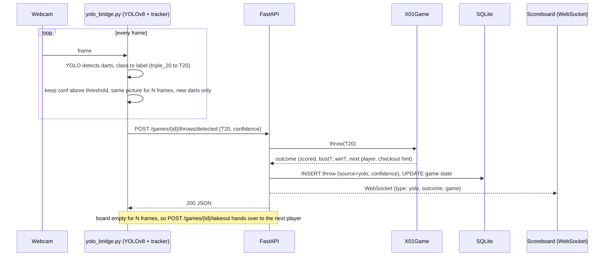
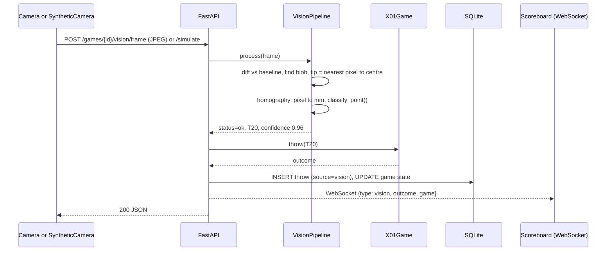
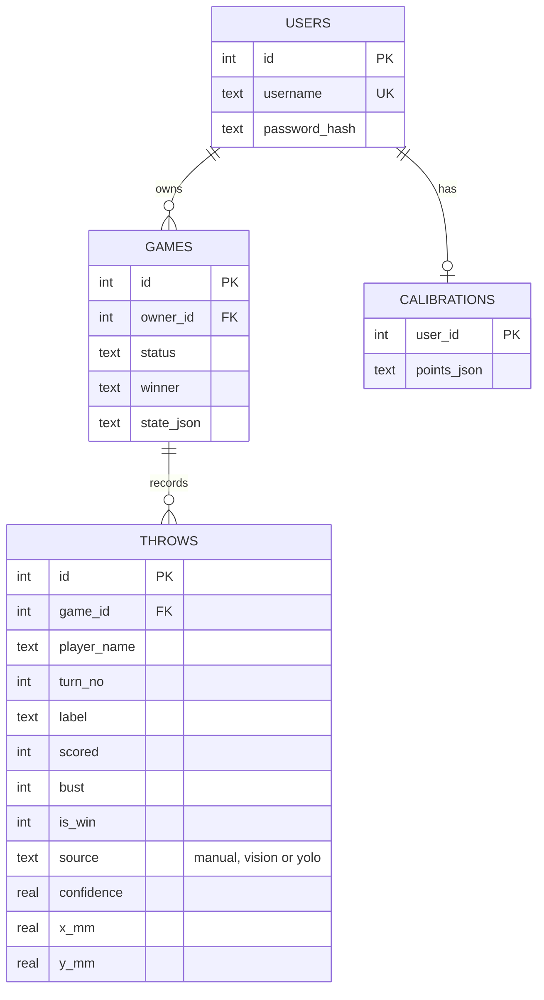
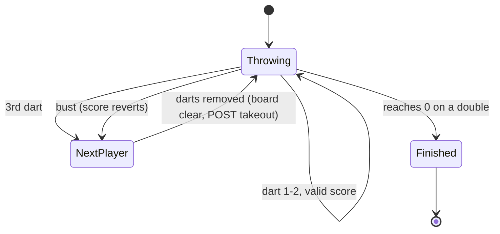

# System Architecture  *(Rubric: System Architecture 5 · Technology Stack 5)*

Render any diagram below at <https://mermaid.live> (or the GitHub/VS Code Mermaid preview) and export PNG/SVG for the slides/video.

**Two detection paths feed the same backend.** The *live hardware path* (diagrams 1, 2, 4a) uses the team's trained YOLOv8 model on a webcam: it recognises which board segment each dart is in and reports it to the API. The *geometry path* (diagram 4b) uses OpenCV background subtraction + a homography; it powers the hardware-free simulator, CI and the benchmark. Both end in the same X01 engine, database and WebSocket scoreboard.

## 1. Network schematic (physical + logical)

## 2. Technology stack (hardware + software)

## 3. UML class diagram (backend + bridge)

## 4a. Sequence - one dart on the live hardware path (YOLO)

## 4b. Sequence - one dart on the geometry path (simulator / fallback)

## 5. Entity-relationship diagram

## 6. Turn state machine

## Design decisions worth stating in the video
* **Layered & modular**: `core/` (rules, pure) -> `vision/` (OpenCV + bridge logic) -> `services/` (orchestration) -> `api/` (HTTP). Each layer is unit-testable alone, and the front-end team can work against the OpenAPI docs at `/docs`.
* **Hardware and backend are decoupled by a tiny contract**: the webcam side only sends `{label, confidence}` and `takeout`. The model can be retrained or replaced without touching the game engine, database or API.
* **A live camera sees every dart in every frame**, so the bridge never scores raw detections: it requires a confidence threshold, a picture that stays identical for N frames, and reconciles each stable picture with the darts it believes are on the board (count-based): a dart re-labelled as a neighbouring segment is matched to the nearest known dart instead of being re-scored, a dart that falls out is dropped, and only the leftovers count as new throws.
* **Provenance is stored**: every throw records `source` (manual / vision / yolo) and `confidence`, so wrong detections can be audited and the model's real-world accuracy measured from the database.
* **Simulation rig**: the geometry pipeline can be fed by a synthetic camera, so the demo and CI never depend on hardware; the YOLO path is tested by replaying detection streams through the real API.
* **Graceful failure**: low-confidence detections are never auto-scored; manual correction + undo always available; an idempotent `takeout` can be retried safely.
