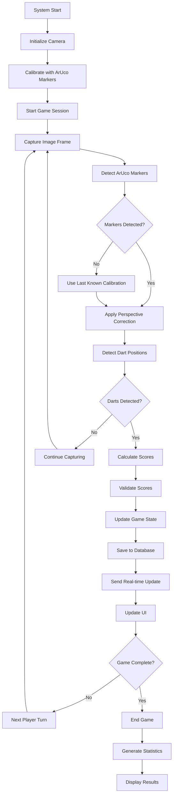

# AI Dartboard Scoring System - Complete Documentation

## 1. Introduction and Overview

The AI Dartboard Scoring System is a comprehensive, intelligent solution that combines computer vision, machine learning, and modern web technologies to automatically detect and score dart throws in real-time. This system revolutionizes traditional dart scoring by eliminating manual scorekeeping and providing instant, accurate results through advanced AI-powered detection.

### System Overview

The AI Dartboard Scoring System captures dartboard images via webcam, processes them using sophisticated computer vision algorithms, and automatically calculates scores based on dart positions. The system supports multiple game modes including Cricket, 501, and Around the Clock, making it suitable for both casual play and competitive tournaments.

### Key Features

- **Real-time Detection**: Instant detection and scoring of dart throws
- **Multiple Game Modes**: Support for Cricket, 501, and Around the Clock
- **Computer Vision Integration**: Advanced OpenCV-based detection with ArUco marker calibration
- **Machine Learning Enhancement**: AI-powered detection for improved accuracy
- **Manual Detection Fallback**: Alternative detection methods for reliability
- **Modern Web Interface**: Responsive, user-friendly interface built with Next.js
- **Real-time Updates**: Live score tracking and game state management
- **Player Management**: Complete player statistics and game history

### System Architecture

The system operates on a client-server architecture with the following main components:

1. **Frontend**: React-based web interface for user interaction
2. **Backend**: API server for game logic and data management
3. **Computer Vision Engine**: OpenCV and ML-based detection system
4. **Database**: SQLite with Prisma ORM for data persistence
5. **Real-time Communication**: Socket.IO for live updates

## 2. Table of Contents

### Frontend Components
- [React Components](#41-react-components)
- [UI Framework](#42-ui-framework)
- [State Management](#43-state-management)
- [Real-time Updates](#44-real-time-updates)
- [Responsive Design](#45-responsive-design)

### Backend Components
- [API Structure](#51-api-structure)
- [Game Logic](#52-game-logic)
- [Authentication](#53-authentication)
- [Database Integration](#54-database-integration)
- [Real-time Communication](#55-real-time-communication)

### Database Structure
- [Schema Design](#61-schema-design)
- [Data Models](#62-data-models)
- [Relationships](#63-relationships)
- [Query Optimization](#64-query-optimization)

### Computer Vision System
- [OpenCV Integration](#71-opencv-integration)
- [ArUco Marker Detection](#72-aruco-marker-detection)
- [Perspective Correction](#73-perspective-correction)
- [Dart Position Calculation](#74-dart-position-calculation)

### Machine Learning Components
- [Model Architecture](#81-model-architecture)
- [Training Process](#82-training-process)
- [Prediction Pipeline](#83-prediction-pipeline)
- [Performance Optimization](#84-performance-optimization)

### Manual Detection System
- [Detection Algorithms](#91-detection-algorithms)
- [Fallback Mechanisms](#92-fallback-mechanisms)
- [User Interface](#93-user-interface)
- [Accuracy Improvement](#94-accuracy-improvement)

### Integration Components
- [System Integration](#101-system-integration)
- [Data Flow](#102-data-flow)
- [Error Handling](#103-error-handling)
- [Performance Monitoring](#104-performance-monitoring)

## 3. Technology Stack

### Frontend Technologies

#### Next.js 15.5.5
**Purpose**: React framework for building the web interface  
**Explanation**: Next.js provides server-side rendering, static site generation, and API routes, enabling a full-stack solution within a single framework. It offers excellent performance, SEO optimization, and a great developer experience with features like hot reloading and automatic code splitting.

#### React 19.2.0
**Purpose**: JavaScript library for building user interfaces  
**Explanation**: React's component-based architecture allows for reusable UI elements and efficient state management. The virtual DOM ensures optimal performance by minimizing direct DOM manipulation.

#### TypeScript 5
**Purpose**: Typed superset of JavaScript  
**Explanation**: TypeScript provides static typing, catching errors at compile time rather than runtime. This leads to more robust code, better IDE support, and improved maintainability, especially in large codebases.

#### Tailwind CSS 4
**Purpose**: Utility-first CSS framework  
**Explanation**: Tailwind CSS enables rapid UI development with its utility-first approach. It provides low-level utility classes that can be composed to build custom designs without writing custom CSS, resulting in faster development and consistent styling.

#### shadcn/ui
**Purpose**: Component library for modern UI  
**Explanation**: shadcn/ui provides accessible, customizable React components built with Radix UI and Tailwind CSS. It ensures consistent design and accessibility across the application.

### Backend Technologies

#### Node.js
**Purpose**: JavaScript runtime environment  
**Explanation**: Node.js enables server-side JavaScript execution, providing an event-driven, non-blocking I/O model that's perfect for real-time applications and handling multiple concurrent connections.

#### Express.js
**Purpose**: Web application framework  
**Explanation**: Express.js simplifies the creation of robust APIs and web applications. It provides middleware support, routing, and HTTP utility methods, making it easier to build scalable server-side applications.

#### Prisma ORM
**Purpose**: Next-generation database toolkit  
**Explanation**: Prisma provides type-safe database access with an intuitive data model. It auto-generates TypeScript types based on your database schema, ensuring type safety and reducing boilerplate code.

#### SQLite
**Purpose**: Lightweight, file-based database  
**Explanation**: SQLite is perfect for development and small to medium-sized applications. It's serverless, requires zero configuration, and provides excellent performance for read-heavy workloads.

### Computer Vision Technologies

#### OpenCV (Open Source Computer Vision Library)
**Purpose**: Computer vision and machine learning software library  
**Explanation**: OpenCV provides comprehensive tools for image processing, feature detection, and machine learning. It's highly optimized and supports real-time computer vision applications, making it ideal for dart detection.

#### ArUco Markers
**Purpose**: Fiducial markers for camera calibration  
**Explanation**: ArUco markers are binary square markers used for camera pose estimation and perspective correction. They enable accurate mapping between camera coordinates and real-world coordinates, essential for precise dart position calculation.

### Machine Learning Technologies

#### TensorFlow.js
**Purpose**: Machine learning library for JavaScript  
**Explanation**: TensorFlow.js enables machine learning directly in the browser or Node.js. It provides pre-trained models and tools for training custom models, allowing for real-time inference without server communication.

#### Custom ML Models
**Purpose**: Dart detection and classification  
**Explanation**: Custom-trained models specifically designed for dart detection provide higher accuracy than generic object detection models. These models are trained on diverse dartboard images to handle various lighting conditions and dart positions.

### Real-time Communication

#### Socket.IO
**Purpose**: Real-time bidirectional event-based communication  
**Explanation**: Socket.IO enables real-time communication between the client and server. It automatically handles connection management, reconnection, and fallback to long polling when WebSocket is not available.

### Development and Deployment

#### ESLint
**Purpose**: JavaScript/TypeScript linting utility  
**Explanation**: ESLint analyzes code to find and fix problems, ensuring code quality and consistency. It's highly configurable and can be customized to enforce specific coding standards.

#### Prettier
**Purpose**: Code formatter  
**Explanation**: Prettier ensures consistent code formatting across the entire codebase. It automatically formats code according to specified rules, improving readability and reducing style debates.

#### Git
**Purpose**: Version control system  
**Explanation**: Git tracks changes in source code during software development, enabling collaboration, version management, and rollback capabilities.

## 4. Frontend Overview

### 4.1 React Components

The frontend is built using React components organized in a logical hierarchy:

#### Main Components

**`DartScannerPC.tsx`**
- Primary component for dart scanning functionality
- Integrates camera feed with detection algorithms
- Manages real-time score display and game state
- Handles user interactions and mode switching

**`DartBoard.tsx`**
- Visual representation of the dartboard
- Renders dart positions and scores
- Provides interactive elements for manual input
- Supports different dartboard types and themes

**`RealTimeScoreDisplay.tsx`**
- Displays current scores and game statistics
- Updates in real-time as darts are detected
- Shows player information and game progress
- Handles score validation and game rules

**`Calibration.tsx`**
- Manages camera calibration process
- Guides users through ArUco marker setup
- Visualizes calibration results
- Stores calibration parameters

#### UI Components

The system uses shadcn/ui components for a consistent, accessible interface:

- **`Card.tsx`**: Container for content sections
- **`Button.tsx`**: Interactive elements with various styles
- **`Input.tsx`**: Form input fields with validation
- **`Progress.tsx`**: Visual progress indicators
- **`Alert.tsx`**: Notification and error messages
- **`Dialog.tsx`**: Modal dialogs for additional information
- **`Tabs.tsx`**: Tabbed interface for different sections

### 4.2 UI Framework

#### Tailwind CSS Integration

The UI is styled using Tailwind CSS with a custom design system:

```typescript
// Example of Tailwind CSS usage in components
<div className="flex flex-col items-center justify-center p-6 bg-gray-900 text-white rounded-lg shadow-lg">
  <h2 className="text-2xl font-bold mb-4">Dart Scanner</h2>
  <div className="w-full max-w-md">
    {/* Component content */}
  </div>
</div>
```

#### Theme System

The application supports light and dark themes:

```typescript
// Theme provider implementation
import { ThemeProvider } from "@/components/theme-provider"

function App() {
  return (
    <ThemeProvider defaultTheme="dark" storageKey="dartboard-theme">
      <div className="min-h-screen bg-background text-foreground">
        {/* Application content */}
      </div>
    </ThemeProvider>
  )
}
```

### 4.3 State Management

#### React Hooks

The system uses various React hooks for state management:

```typescript
// Custom hook for game state
import { useGameState } from "@/hooks/useGameState"

function DartScanner() {
  const { gameState, updateScore, nextPlayer } = useGameState()
  
  return (
    <div>
      {/* Game state display */}
    </div>
  )
}
```

#### Zustand for Global State

For complex state management, the system uses Zustand:

```typescript
// Game store implementation
import { create } from 'zustand'

interface GameState {
  currentPlayer: string
  scores: Record<string, number>
  gameMode: string
  updateScore: (player: string, score: number) => void
}

export const useGameStore = create<GameState>((set) => ({
  currentPlayer: '',
  scores: {},
  gameMode: '501',
  updateScore: (player, score) => set((state) => ({
    scores: { ...state.scores, [player]: (state.scores[player] || 0) + score }
  }))
}))
```

### 4.4 Real-time Updates

#### Socket.IO Integration

Real-time updates are handled through Socket.IO:

```typescript
// Socket connection setup
import { io } from 'socket.io-client'

const socket = io('http://localhost:3000')

socket.on('score-update', (data) => {
  // Update UI with new score
})

socket.on('game-state', (gameState) => {
  // Update game state
})
```

#### Live Score Updates

The system provides immediate visual feedback:

```typescript
// Real-time score update handler
const handleScoreUpdate = useCallback((data: ScoreUpdate) => {
  setScores(prev => ({
    ...prev,
    [data.player]: data.newScore
  }))
  
  // Show notification
  toast({
    title: "Score Updated",
    description: `${data.player} scored ${data.score} points!`
  })
}, [])
```

### 4.5 Responsive Design

#### Mobile-First Approach

The interface is designed with a mobile-first approach:

```typescript
// Responsive design implementation
<div className="grid grid-cols-1 md:grid-cols-2 lg:grid-cols-3 gap-4 p-4">
  <div className="w-full md:w-96">
    {/* Content that adapts to screen size */}
  </div>
</div>
```

#### Breakpoint System

The system uses Tailwind's responsive breakpoints:

- **`sm:`** - Small screens (640px)
- **`md:`** - Medium screens (768px)
- **`lg:`** - Large screens (1024px)
- **`xl:`** - Extra large screens (1280px)

#### Touch-Friendly Interface

All interactive elements are designed for touch interaction:

```typescript
// Touch-friendly button implementation
<button 
  className="p-4 min-h-[44px] touch-manipulation"
  onClick={handleClick}
>
  Click Me
</button>
```

## 5. Backend Overview

### 5.1 API Structure

The backend is built using Express.js with a well-organized API structure:

#### Route Organization

```typescript
// API route structure
src/app/api/
├── camera/
│   ├── control/route.ts     # Camera control endpoints
│   ├── stream/route.ts      # Video stream handling
│   └── capture/route.ts    # Image capture
├── games/
│   ├── [id]/route.ts        # Individual game operations
│   └── route.ts             # Game CRUD operations
├── players/
│   └── route.ts             # Player management
├── throws/
│   └── route.ts             # Throw data processing
└── health/
    └── route.ts             # System health check
```

#### API Endpoints

**Game Management**
```typescript
// Game CRUD operations
export async function GET(request: Request) {
  const games = await prisma.game.findMany()
  return NextResponse.json(games)
}

export async function POST(request: Request) {
  const body = await request.json()
  const game = await prisma.game.create({
    data: body
  })
  return NextResponse.json(game)
}
```

**Player Management**
```typescript
// Player operations
export async function GET() {
  const players = await prisma.player.findMany()
  return NextResponse.json(players)
}

export async function POST(request: Request) {
  const { name } = await request.json()
  const player = await prisma.player.create({
    data: { name }
  })
  return NextResponse.json(player)
}
```

### 5.2 Game Logic

#### Game Engine

The game logic is implemented in a separate module:

```typescript
// Game engine implementation
import { GameEngine } from '@/lib/game-engine'

class DartGameEngine implements GameEngine {
  private gameState: GameState
  private rules: GameRules
  
  constructor(gameMode: string) {
    this.rules = this.loadRules(gameMode)
    this.gameState = this.initializeGameState()
  }
  
  async processThrow(throwData: ThrowData): Promise<ProcessResult> {
    const validation = this.validateThrow(throwData)
    if (!validation.isValid) {
      return { success: false, error: validation.error }
    }
    
    const score = this.calculateScore(throwData)
    const updatedState = this.updateGameState(score)
    
    return {
      success: true,
      gameState: updatedState,
      score
    }
  }
}
```

#### Game Rules Implementation

```typescript
// Game rules for different modes
class GameRules {
  static cricket = {
    targetNumbers: [15, 16, 17, 18, 19, 20, 25],
    hitsToClose: 3,
    scoring: 'points'
  }
  
  static game501 = {
    startingScore: 501,
    doubleOut: true,
    bustRule: true
  }
  
  static aroundTheClock = {
    sequence: Array.from({ length: 20 }, (_, i) => i + 1),
    targetHit: true
  }
}
```

### 5.3 Authentication

#### NextAuth.js Integration

The system uses NextAuth.js for authentication:

```typescript
// Authentication configuration
import NextAuth from 'next-auth'
import CredentialsProvider from 'next-auth/providers/credentials'

export const authOptions = {
  providers: [
    CredentialsProvider({
      name: 'credentials',
      credentials: {
        username: { label: 'Username', type: 'text' },
        password: { label: 'Password', type: 'password' }
      },
      async authorize(credentials) {
        // Add authentication logic here
        return { id: '1', name: 'Player', email: 'player@example.com' }
      }
    })
  ],
  session: { strategy: 'jwt' },
  pages: { signIn: '/auth/signin' }
}
```

### 5.4 Database Integration

#### Prisma ORM

The system uses Prisma for type-safe database operations:

```typescript
// Database schema
model Player {
  id        String   @id @default(cuid())
  name      String
  createdAt DateTime @default(now())
  updatedAt DateTime @updatedAt
  
  games     Game[]
  throws    Throw[]
  
  @@map('players')
}

model Game {
  id          String   @id @default(cuid())
  mode        String
  status      String   @default('active')
  createdAt   DateTime @default(now())
  updatedAt   DateTime @updatedAt
  
  players     Player[]
  throws      Throw[]
  
  @@map('games')
}

model Throw {
  id        String   @id @default(cuid())
  playerId  String
  gameId    String
  x         Float
  y         Float
  score     Int
  timestamp DateTime @default(now())
  
  player    Player   @relation(fields: [playerId], references: [id])
  game      Game     @relation(fields: [gameId], references: [id])
  
  @@map('throws')
}
```

#### Database Operations

```typescript
// Database service
import { PrismaClient } from '@prisma/client'

const prisma = new PrismaClient()

export class DatabaseService {
  async createGame(gameData: CreateGameData) {
    return await prisma.game.create({
      data: gameData,
      include: { players: true }
    })
  }
  
  async addThrow(throwData: CreateThrowData) {
    return await prisma.throw.create({
      data: throwData,
      include: { player: true }
    })
  }
  
  async getGameHistory(gameId: string) {
    return await prisma.throw.findMany({
      where: { gameId },
      orderBy: { timestamp: 'asc' },
      include: { player: true }
    })
  }
}
```

### 5.5 Real-time Communication

#### Socket.IO Server

The backend uses Socket.IO for real-time communication:

```typescript
// Socket.IO server setup
import { Server } from 'socket.io'
import { createServer } from 'http'

const server = createServer()
const io = new Server(server, {
  cors: {
    origin: process.env.NEXT_PUBLIC_APP_URL,
    methods: ['GET', 'POST']
  }
})

io.on('connection', (socket) => {
  console.log('Client connected:', socket.id)
  
  socket.on('join-game', (gameId) => {
    socket.join(gameId)
    socket.emit('joined-game', { gameId })
  })
  
  socket.on('throw-processed', (data) => {
    io.to(data.gameId).emit('score-update', data)
  })
})
```

#### Event Handling

```typescript
// Event types and handlers
interface GameEvent {
  type: 'score-update' | 'game-state' | 'player-joined'
  gameId: string
  data: any
}

class GameEventHandler {
  constructor(private io: Server) {}
  
  handleScoreUpdate(gameId: string, scoreData: ScoreData) {
    this.io.to(gameId).emit('score-update', {
      type: 'score-update',
      gameId,
      data: scoreData
    })
  }
  
  handleGameStateChange(gameId: string, gameState: GameState) {
    this.io.to(gameId).emit('game-state', {
      type: 'game-state',
      gameId,
      data: gameState
    })
  }
}
```

## 6. Database Overview

### 6.1 Schema Design

The database schema is designed to support the dart scoring system's requirements:

#### Core Tables

**Players Table**
```sql
CREATE TABLE players (
  id VARCHAR(36) PRIMARY KEY,
  name VARCHAR(255) NOT NULL,
  created_at TIMESTAMP DEFAULT CURRENT_TIMESTAMP,
  updated_at TIMESTAMP DEFAULT CURRENT_TIMESTAMP ON UPDATE CURRENT_TIMESTAMP
);
```

**Games Table**
```sql
CREATE TABLE games (
  id VARCHAR(36) PRIMARY KEY,
  mode VARCHAR(50) NOT NULL,
  status VARCHAR(50) DEFAULT 'active',
  created_at TIMESTAMP DEFAULT CURRENT_TIMESTAMP,
  updated_at TIMESTAMP DEFAULT CURRENT_TIMESTAMP ON UPDATE CURRENT_TIMESTAMP
);
```

**Throws Table**
```sql
CREATE TABLE throws (
  id VARCHAR(36) PRIMARY KEY,
  player_id VARCHAR(36) NOT NULL,
  game_id VARCHAR(36) NOT NULL,
  x FLOAT NOT NULL,
  y FLOAT NOT NULL,
  score INTEGER NOT NULL,
  timestamp TIMESTAMP DEFAULT CURRENT_TIMESTAMP,
  FOREIGN KEY (player_id) REFERENCES players(id),
  FOREIGN KEY (game_id) REFERENCES games(id)
);
```

### 6.2 Data Models

#### Prisma Models

```typescript
// Complete Prisma schema
generator client {
  provider = "prisma-client-js"
}

datasource db {
  provider = "sqlite"
  url      = "file:./AIDartboard.db"
}

model Player {
  id        String   @id @default(cuid())
  name      String   @unique
  email     String?  @unique
  avatar    String?
  createdAt DateTime @default(now())
  updatedAt DateTime @updatedAt
  
  games     GamePlayer[]
  throws    Throw[]
  statistics PlayerStatistics[]
  
  @@map('players')
}

model Game {
  id          String   @id @default(cuid())
  mode        String   // 'cricket', '501', 'around_the_clock'
  status      String   @default('active') // 'active', 'completed', 'paused'
  createdAt   DateTime @default(now())
  updatedAt   DateTime @updatedAt
  
  players     GamePlayer[]
  throws      Throw[]
  settings    GameSettings?
  
  @@map('games')
}

model GamePlayer {
  id        String   @id @default(cuid())
  gameId    String
  playerId  String
  position  Int      // Player order in the game
  joinedAt  DateTime @default(now())
  
  game      Game     @relation(fields: [gameId], references: [id])
  player    Player   @relation(fields: [playerId], references: [id])
  
  @@unique([gameId, playerId])
  @@map('game_players')
}

model Throw {
  id        String   @id @default(cuid())
  playerId  String
  gameId    String
  x         Float    // Normalized position (0-1)
  y         Float    // Normalized position (0-1)
  score     Int      // Calculated score
  multiplier Int     // 1, 2, or 3
  segment   String?  // 'single', 'double', 'triple', 'bull'
  timestamp DateTime @default(now())
  
  player    Player   @relation(fields: [playerId], references: [id])
  game      Game     @relation(fields: [gameId], references: [id])
  
  @@map('throws')
}

model GameSettings {
  id           String   @id @default(cuid())
  gameId       String   @unique
  startingScore Int?    // For 501 games
  doubleOut    Boolean  @default(false)
  bustRule     Boolean  @default(true)
  
  game         Game     @relation(fields: [gameId], references: [id])
  
  @@map('game_settings')
}

model PlayerStatistics {
  id            String   @id @default(cuid())
  playerId      String   @unique
  gamesPlayed   Int      @default(0)
  gamesWon      Int      @default(0)
  totalScore    Int      @default(0)
  averageScore  Float    @default(0)
  bestScore     Int?
  createdAt     DateTime @default(now())
  updatedAt     DateTime @updatedAt
  
  player        Player   @relation(fields: [playerId], references: [id])
  
  @@map('player_statistics')
}
```

### 6.3 Relationships

#### Entity Relationship Diagram

```
Players (1) ---- (N) GamePlayers (N) ---- (1) Games
    |                                          |
    |                                          |
    |                                          |
  Throws (N)                               GameSettings (1)
    |
    |
  PlayerStatistics (1)
```

#### Key Relationships

**Player-Game Relationship**
- Many-to-many through GamePlayer table
- Tracks player position in game
- Supports multiple players per game

**Throw-Game Relationship**
- Each throw belongs to one game
- Each game can have multiple throws
- Maintains chronological order

**Player-Statistics Relationship**
- One-to-one relationship
- Aggregated performance data
- Updated after each game

### 6.4 Query Optimization

#### Indexed Fields

```typescript
// Database indexes for performance
model Throw {
  id        String   @id @default(cuid())
  playerId  String
  gameId    String
  timestamp DateTime @default(now())
  
  // Indexes for common queries
  @@index([playerId])
  @@index([gameId])
  @@index([timestamp])
  @@index([gameId, timestamp])
}
```

#### Optimized Queries

```typescript
// Efficient game history query
async function getGameHistory(gameId: string) {
  return await prisma.throw.findMany({
    where: { gameId },
    orderBy: { timestamp: 'asc' },
    include: {
      player: {
        select: {
          id: true,
          name: true
        }
      }
    }
  })
}

// Player statistics query
async function getPlayerStatistics(playerId: string) {
  return await prisma.player.findUnique({
    where: { id: playerId },
    include: {
      statistics: true,
      throws: {
        select: {
          score: true,
          timestamp: true
        }
      }
    }
  })
}
```

#### Database Connection Management

```typescript
// Connection pooling and optimization
const prisma = new PrismaClient({
  log: ['query', 'info', 'warn', 'error'],
  datasources: {
    db: {
      url: process.env.DATABASE_URL,
      connectionLimit: 10,
      queueLimit: 5
    }
  }
})
```

## 7. Integration Explanation

### 7.1 System Integration

The AI Dartboard Scoring System integrates multiple technologies and components to create a seamless experience:

#### Component Integration Architecture

```
Frontend (React/Next.js)
    ↓ HTTP/WebSocket
Backend API (Express.js)
    ↓ Database Queries
Database (SQLite/Prisma)
    ↓ Real-time Events
Computer Vision Engine (OpenCV)
    ↓ Processed Data
Machine Learning Model
    ↓ Detection Results
Frontend Display
```

#### Integration Points

**Frontend-Backend Integration**
```typescript
// API service for frontend-backend communication
class ApiService {
  private baseUrl: string
  
  async processThrow(throwData: ThrowData): Promise<ProcessResult> {
    const response = await fetch(`${this.baseUrl}/api/throws`, {
      method: 'POST',
      headers: { 'Content-Type': 'application/json' },
      body: JSON.stringify(throwData)
    })
    return response.json()
  }
  
  async getGameState(gameId: string): Promise<GameState> {
    const response = await fetch(`${this.baseUrl}/api/games/${gameId}`)
    return response.json()
  }
}
```

**Backend-Database Integration**
```typescript
// Database service for backend-database communication
class DatabaseService {
  async saveThrow(throwData: ThrowData): Promise<Throw> {
    return await prisma.throw.create({
      data: {
        playerId: throwData.playerId,
        gameId: throwData.gameId,
        x: throwData.position.x,
        y: throwData.position.y,
        score: throwData.score,
        multiplier: throwData.multiplier
      }
    })
  }
  
  async updateGameStats(gameId: string): Promise<void> {
    // Update game statistics
    const throws = await prisma.throw.findMany({
      where: { gameId },
      include: { player: true }
    })
    
    // Calculate and update statistics
    for (const throw of throws) {
      await prisma.playerStatistics.update({
        where: { playerId: throw.playerId },
        data: {
          totalScore: { increment: throw.score },
          averageScore: { /* recalculate */ }
        }
      })
    }
  }
}
```

### 7.2 Data Flow

#### Complete Data Flow Diagram

```
Camera Input
    ↓
Image Capture
    ↓
OpenCV Processing
    ↓
ArUco Marker Detection
    ↓
Perspective Correction
    ↓
Dart Position Detection
    ↓
Score Calculation
    ↓
Backend API
    ↓
Database Storage
    ↓
Real-time Update (Socket.IO)
    ↓
Frontend Display
```

#### Detailed Data Flow Steps

**Step 1: Image Capture**
```typescript
// Camera service handles image capture
class CameraService {
  async captureFrame(): Promise<ImageData> {
    const video = this.videoElement
    const canvas = document.createElement('canvas')
    canvas.width = video.videoWidth
    canvas.height = video.videoHeight
    
    const ctx = canvas.getContext('2d')
    ctx.drawImage(video, 0, 0)
    
    return ctx.getImageData(0, 0, canvas.width, canvas.height)
  }
}
```

**Step 2: OpenCV Processing**
```python
# OpenCV processing pipeline
def process_image(image):
    # Detect ArUco markers
    corners, ids, _ = detect_aruco_markers(image)
    
    if len(corners) >= 4:
        # Calculate perspective transformation
        transformation_matrix = get_perspective_transform(corners)
        
        # Apply perspective correction
        corrected_image = cv2.warpPerspective(image, transformation_matrix, (500, 500))
        
        # Detect dart positions
        dart_positions = detect_darts(corrected_image)
        
        return {
            'corrected_image': corrected_image,
            'dart_positions': dart_positions,
            'transformation_matrix': transformation_matrix
        }
    
    return None
```

**Step 3: Score Calculation**
```typescript
// Score calculation service
class ScoreCalculator {
  calculateScore(position: Position): ScoreResult {
    const polar = this.cartesianToPolar(position)
    const segment = this.getSegment(polar.angle, polar.radius)
    
    return {
      baseScore: segment.number,
      multiplier: segment.multiplier,
      totalScore: segment.number * segment.multiplier,
      segment: segment.type
    }
  }
  
  private cartesianToPolar(position: Position): PolarPosition {
    const x = position.x - 0.5  // Center at (0.5, 0.5)
    const y = position.y - 0.5
    
    const radius = Math.sqrt(x * x + y * y)
    const angle = Math.atan2(y, x) * 180 / Math.PI
    
    return { radius, angle: (angle + 360) % 360 }
  }
}
```

**Step 4: Real-time Update**
```typescript
// Real-time update service
class RealtimeService {
  constructor(private socket: SocketIO.Socket) {}
  
  sendScoreUpdate(gameId: string, scoreData: ScoreData) {
    this.socket.emit('score-update', {
      gameId,
      timestamp: Date.now(),
      ...scoreData
    })
  }
  
  onScoreUpdate(callback: (data: ScoreUpdate) => void) {
    this.socket.on('score-update', callback)
  }
}
```

### 7.3 Error Handling

#### Comprehensive Error Handling Strategy

**Frontend Error Handling**
```typescript
// Error boundary component
class ErrorBoundary extends React.Component {
  state = { hasError: false, error: null }
  
  static getDerivedStateFromError(error: Error) {
    return { hasError: true, error }
  }
  
  componentDidCatch(error: Error, errorInfo: React.ErrorInfo) {
    console.error('Error caught by boundary:', error, errorInfo)
    
    // Send error to monitoring service
    this.sendErrorToMonitoring(error, errorInfo)
  }
  
  render() {
    if (this.state.hasError) {
      return <ErrorDisplay error={this.state.error} />
    }
    
    return this.props.children
  }
}
```

**Backend Error Handling**
```typescript
// Global error handler middleware
app.use((err: Error, req: Request, res: Response, next: NextFunction) => {
  console.error('Unhandled error:', err)
  
  if (err instanceof Prisma.PrismaClientKnownRequestError) {
    return res.status(400).json({
      error: 'Database error',
      code: err.code
    })
  }
  
  if (err instanceof ValidationError) {
    return res.status(400).json({
      error: 'Validation error',
      details: err.details
    })
  }
  
  res.status(500).json({
    error: 'Internal server error'
  })
})
```

**Computer Vision Error Handling**
```python
# OpenCV error handling
def safe_detect_markers(image):
    try:
        corners, ids, _ = detect_aruco_markers(image)
        
        if corners is None or len(corners) < 4:
            raise DetectionError("Insufficient markers detected")
        
        return corners, ids
        
    except cv2.error as e:
        raise DetectionError(f"OpenCV error: {str(e)}")
    except Exception as e:
        raise DetectionError(f"Detection failed: {str(e)}")
```

### 7.4 Performance Monitoring

#### Performance Metrics Collection

**Frontend Performance Monitoring**
```typescript
// Performance monitoring service
class PerformanceMonitor {
  private metrics: PerformanceMetrics[] = []
  
  measureDetectionTime(callback: () => Promise<void>): Promise<number> {
    const start = performance.now()
    
    return callback().then(() => {
      const end = performance.now()
      const duration = end - start
      
      this.metrics.push({
        type: 'detection',
        duration,
        timestamp: Date.now()
      })
      
      return duration
    })
  }
  
  getAverageDetectionTime(): number {
    const detectionMetrics = this.metrics.filter(m => m.type === 'detection')
    if (detectionMetrics.length === 0) return 0
    
    const total = detectionMetrics.reduce((sum, m) => sum + m.duration, 0)
    return total / detectionMetrics.length
  }
}
```

**Backend Performance Monitoring**
```typescript
// API performance middleware
const performanceMiddleware = (req: Request, res: Response, next: NextFunction) => {
  const start = Date.now()
  
  res.on('finish', () => {
    const duration = Date.now() - start
    
    // Log performance metrics
    console.log(`${req.method} ${req.path} - ${duration}ms`)
    
    // Store metrics for analysis
    storePerformanceMetric({
      endpoint: req.path,
      method: req.method,
      duration,
      timestamp: new Date()
    })
  })
  
  next()
}
```

## 8. Logic Flow of the System

### 8.1 System Logic Flow

The AI Dartboard Scoring System follows a comprehensive logic flow that integrates all components:

#### High-Level System Flow

```
1. System Initialization
   ├─ Camera setup and calibration
   ├─ Database connection
   ├─ WebSocket connection
   └─ Game state initialization

2. Image Capture Loop
   ├─ Continuous video stream capture
   ├─ Frame buffering
   └─ Image preprocessing

3. Computer Vision Processing
   ├─ ArUco marker detection
   ├─ Perspective correction
   ├─ Dart position detection
   └─ Score calculation

4. Game Logic Processing
   ├─ Score validation
   ├─ Game rule application
   ├─ Player turn management
   └─ Game state updates

5. Real-time Updates
   ├─ WebSocket event emission
   ├─ Frontend state updates
   ├─ UI refresh
   └─ User feedback

6. Data Persistence
   ├─ Throw data storage
   ├─ Game history updates
   ├─ Player statistics calculation
   └─ Database transaction completion
```

#### Detailed Logic Flow Diagram



### 8.2 Game Logic Flow

#### Game Initialization Flow

```typescript
// Game initialization logic
class GameInitializer {
  async initializeGame(gameMode: string, players: string[]): Promise<GameState> {
    // Validate game mode
    const rules = this.validateGameMode(gameMode)
    
    // Create game in database
    const game = await this.createGame({
      mode: gameMode,
      status: 'active'
    })
    
    // Add players to game
    const gamePlayers = await this.addPlayersToGame(game.id, players)
    
    // Initialize game state
    const gameState = this.createGameState({
      gameId: game.id,
      players: gamePlayers,
      rules: rules
    })
    
    // Start real-time session
    await this.startGameSession(game.id)
    
    return gameState
  }
}
```

#### Turn Management Flow

```typescript
// Turn management logic
class TurnManager {
  async processTurn(throwData: ThrowData): Promise<TurnResult> {
    // Validate throw
    const validation = this.validateThrow(throwData)
    if (!validation.isValid) {
      return { success: false, error: validation.error }
    }
    
    // Calculate score
    const score = this.calculateScore(throwData)
    
    // Apply game rules
    const ruleResult = this.applyGameRules(score)
    
    // Update game state
    const gameState = this.updateGameState(ruleResult)
    
    // Check for game completion
    const gameComplete = this.checkGameCompletion(gameState)
    
    // Save turn data
    await this.saveTurn({
      ...throwData,
      score: ruleResult.finalScore
    })
    
    // Update statistics
    await this.updatePlayerStatistics(throwData.playerId, ruleResult)
    
    return {
      success: true,
      gameState,
      gameComplete,
      score: ruleResult.finalScore
    }
  }
}
```

### 8.3 Detection Logic Flow

#### Computer Vision Detection Flow

```python
# Computer vision detection flow
class DartDetector:
    def detect_darts(self, image):
        # Step 1: Preprocess image
        preprocessed = self.preprocess_image(image)
        
        # Step 2: Detect ArUco markers
        markers = self.detect_aruco_markers(preprocessed)
        
        # Step 3: Calculate perspective transform
        if markers:
            transform_matrix = self.get_perspective_transform(markers)
            corrected = self.apply_perspective_correction(preprocessed, transform_matrix)
        else:
            corrected = preprocessed
            transform_matrix = None
        
        # Step 4: Detect dart positions
        dart_positions = self.detect_dart_positions(corrected)
        
        # Step 5: Convert to normalized coordinates
        normalized_positions = self.normalize_positions(dart_positions, transform_matrix)
        
        # Step 6: Calculate scores
        scores = [self.calculate_score(pos) for pos in normalized_positions]
        
        return {
            'positions': normalized_positions,
            'scores': scores,
            'calibration_valid': markers is not None
        }
```

#### Machine Learning Detection Flow

```typescript
// Machine learning detection flow
class MLDetector {
  async detectDarts(image: ImageData): Promise<DetectionResult[]> {
    // Preprocess image for ML model
    const preprocessed = await this.preprocessImage(image)
    
    // Run ML model inference
    const predictions = await this.model.predict(preprocessed)
    
    // Process predictions
    const detections = this.processPredictions(predictions)
    
    // Filter and validate detections
    const validDetections = this.filterDetections(detections)
    
    // Convert to dart positions
    const dartPositions = validDetections.map(d => this.toDartPosition(d))
    
    return dartPositions
  }
  
  private async preprocessImage(image: ImageData): Promise<Tensor> {
    // Convert to tensor
    const tensor = tf.browser.fromPixels(image)
    
    // Resize to model input size
    const resized = tf.image.resizeBilinear(tensor, [224, 224])
    
    // Normalize pixel values
    const normalized = resized.div(255.0)
    
    // Add batch dimension
    return normalized.expandDims(0)
  }
}
```

### 8.4 Real-time Logic Flow

#### WebSocket Event Flow

```typescript
// Real-time event flow
class RealtimeManager {
  constructor(private socket: SocketIO.Socket) {
    this.setupEventHandlers()
  }
  
  private setupEventHandlers() {
    // Game events
    this.socket.on('game-joined', (data) => this.handleGameJoined(data))
    this.socket.on('player-turn', (data) => this.handlePlayerTurn(data))
    this.socket.on('score-update', (data) => this.handleScoreUpdate(data))
    this.socket.on('game-ended', (data) => this.handleGameEnded(data))
    
    // System events
    this.socket.on('connection', () => this.handleConnection())
    this.socket.on('disconnect', () => this.handleDisconnection())
    this.socket.on('error', (error) => this.handleError(error))
  }
  
  private handleScoreUpdate(data: ScoreUpdate) {
    // Update local game state
    this.gameState.updateScore(data.playerId, data.score)
    
    // Update UI
    this.ui.updateScoreDisplay(data)
    
    // Show notification
    this.notifications.showScoreUpdate(data)
    
    // Play sound effect
    this.soundManager.playScoreSound(data.score)
  }
}
```

#### State Synchronization Flow

```typescript
// State synchronization logic
class StateSynchronizer {
  async synchronizeState(serverState: GameState): Promise<void> {
    // Compare server and client state
    const diff = this.compareStates(this.localState, serverState)
    
    // Apply differences
    for (const change of diff.changes) {
      await this.applyStateChange(change)
    }
    
    // Update local state
    this.localState = serverState
    
    // Trigger UI updates
    this.triggerStateUpdate()
  }
  
  private compareStates(local: GameState, server: GameState): StateDiff {
    const changes: StateChange[] = []
    
    // Compare player scores
    for (const [playerId, serverScore] of Object.entries(server.scores)) {
      const localScore = local.scores[playerId] || 0
      if (localScore !== serverScore) {
        changes.push({
          type: 'score',
          playerId,
          oldScore: localScore,
          newScore: serverScore
        })
      }
    }
    
    // Compare game status
    if (local.status !== server.status) {
      changes.push({
        type: 'status',
        oldStatus: local.status,
        newStatus: server.status
      })
    }
    
    return { changes }
  }
}
```

## 9. Logic Code Flow

### 9.1 Main Application Flow

#### Entry Point and Initialization

```typescript
// Main application entry point
// src/app/page.tsx
'use client'

import { useEffect, useState } from 'react'
import { DartScanner } from '@/components/dart-scanner-pc'
import { GameProvider } from '@/context/game-context'

export default function Home() {
  const [isLoading, setIsLoading] = useState(true)
  const [error, setError] = useState<string | null>(null)
  
  useEffect(() => {
    // Initialize application
    const initializeApp = async () => {
      try {
        // Initialize camera
        await initializeCamera()
        
        // Load game state
        await loadGameState()
        
        // Connect to real-time services
        await connectRealtime()
        
        setIsLoading(false)
      } catch (err) {
        setError(err.message)
        setIsLoading(false)
      }
    }
    
    initializeApp()
  }, [])
  
  if (isLoading) {
    return <LoadingScreen />
  }
  
  if (error) {
    return <ErrorScreen error={error} />
  }
  
  return (
    <GameProvider>
      <div className="min-h-screen bg-background text-foreground">
        <DartScanner />
      </div>
    </GameProvider>
  )
}
```

#### Camera Initialization Flow

```typescript
// Camera service initialization
// src/lib/camera-service.ts
export class CameraService {
  private video: HTMLVideoElement | null = null
  private stream: MediaStream | null = null
  private isInitialized = false
  
  async initialize(videoElement: HTMLVideoElement): Promise<void> {
    if (this.isInitialized) {
      return
    }
    
    this.video = videoElement
    
    try {
      // Request camera access
      this.stream = await navigator.mediaDevices.getUserMedia({
        video: {
          width: { ideal: 1920 },
          height: { ideal: 1080 },
          facingMode: 'environment'
        }
      })
      
      // Set video source
      this.video.srcObject = this.stream
      
      // Wait for video to load
      await new Promise((resolve, reject) => {
        if (this.video) {
          this.video.onloadedmetadata = resolve
          this.video.onerror = reject
        }
      })
      
      // Start video playback
      this.video.play()
      
      this.isInitialized = true
      console.log('Camera initialized successfully')
      
    } catch (error) {
      console.error('Camera initialization failed:', error)
      throw new CameraError('Failed to initialize camera')
    }
  }
  
  async captureFrame(): Promise<ImageData> {
    if (!this.video || !this.isInitialized) {
      throw new CameraError('Camera not initialized')
    }
    
    const canvas = document.createElement('canvas')
    const ctx = canvas.getContext('2d')
    
    if (!ctx) {
      throw new CameraError('Canvas context not available')
    }
    
    canvas.width = this.video.videoWidth
    canvas.height = this.video.videoHeight
    
    ctx.drawImage(this.video, 0, 0)
    
    return ctx.getImageData(0, 0, canvas.width, canvas.height)
  }
  
  stop(): void {
    if (this.stream) {
      this.stream.getTracks().forEach(track => track.stop())
      this.stream = null
    }
    
    this.isInitialized = false
  }
}
```

### 9.2 Detection Processing Flow

#### OpenCV Detection Flow

```python
# OpenCV detection pipeline
# config4.py
import cv2
import numpy as np

class DartDetector:
    def __init__(self):
        self.aruco_dict = cv2.aruco.getPredefinedDictionary(cv2.aruco.DICT_4X4_50)
        self.aruco_params = cv2.aruco.DetectorParameters()
        self.calibration_matrix = None
        self.distortion_coeffs = None
        
    def detect_and_process(self, image):
        """Main detection pipeline"""
        try:
            # Step 1: Detect ArUco markers
            corners, ids, _ = cv2.aruco.detectMarkers(
                image, self.aruco_dict, parameters=self.aruco_params
            )
            
            if corners is None or len(corners) < 4:
                return {"status": "error", "message": "Insufficient markers detected"}
            
            # Step 2: Get perspective transformation
            transformation_matrix = self.get_perspective_transform(corners, ids)
            
            # Step 3: Apply perspective correction
            corrected_image = cv2.warpPerspective(
                image, transformation_matrix, (500, 500)
            )
            
            # Step 4: Detect dart positions
            dart_positions = self.detect_dart_positions(corrected_image)
            
            # Step 5: Calculate scores
            scores = []
            for position in dart_positions:
                score = self.calculate_score(position)
                scores.append(score)
            
            return {
                "status": "success",
                "positions": dart_positions,
                "scores": scores,
                "corrected_image": corrected_image,
                "transformation_matrix": transformation_matrix
            }
            
        except Exception as e:
            return {"status": "error", "message": str(e)}
    
    def get_perspective_transform(self, corners, ids):
        """Calculate perspective transformation matrix"""
        # Define source and destination points
        src_points = []
        dst_points = np.array([
            [0, 0], [500, 0], [500, 500], [0, 500]
        ], dtype=np.float32)
        
        # Map marker corners to destination points
        for i, marker_id in enumerate([0, 1, 2, 3]):
            marker_index = np.where(ids == marker_id)[0]
            if len(marker_index) > 0:
                marker_corners = corners[marker_index[0]][0]
                center = np.mean(marker_corners, axis=0)
                src_points.append(center)
        
        if len(src_points) == 4:
            src_points = np.array(src_points, dtype=np.float32)
            return cv2.getPerspectiveTransform(src_points, dst_points)
        
        raise Exception("Could not map all required markers")
    
    def detect_dart_positions(self, image):
        """Detect dart positions in corrected image"""
        # Convert to grayscale
        gray = cv2.cvtColor(image, cv2.COLOR_BGR2GRAY)
        
        # Apply Gaussian blur
        blurred = cv2.GaussianBlur(gray, (5, 5), 0)
        
        # Detect edges
        edges = cv2.Canny(blurred, 50, 150)
        
        # Find contours
        contours, _ = cv2.findContours(edges, cv2.RETR_EXTERNAL, cv2.CHAIN_APPROX_SIMPLE)
        
        dart_positions = []
        for contour in contours:
            # Filter small contours
            if cv2.contourArea(contour) < 100:
                continue
            
            # Get bounding rectangle
            x, y, w, h = cv2.boundingRect(contour)
            
            # Calculate center point
            center_x = x + w / 2
            center_y = y + h / 2
            
            # Normalize to 0-1 range
            normalized_x = center_x / image.shape[1]
            normalized_y = center_y / image.shape[0]
            
            dart_positions.append({
                'x': normalized_x,
                'y': normalized_y,
                'confidence': cv2.contourArea(contour) / (image.shape[0] * image.shape[1])
            })
        
        return dart_positions
    
    def calculate_score(self, position):
        """Calculate score from normalized position"""
        x, y = position['x'], position['y']
        
        # Convert to polar coordinates
        center_x, center_y = 0.5, 0.5
        dx = x - center_x
        dy = y - center_y
        
        radius = np.sqrt(dx**2 + dy**2)
        angle = np.arctan2(dy, dx) * 180 / np.pi
        
        # Normalize angle to 0-360
        angle = (angle + 360) % 360
        
        # Determine segment
        segment_number = self.get_segment_number(angle)
        
        # Determine multiplier based on radius
        multiplier = self.get_multiplier(radius)
        
        return {
            'segment': segment_number,
            'multiplier': multiplier,
            'total_score': segment_number * multiplier
        }
    
    def get_segment_number(self, angle):
        """Get dartboard segment number from angle"""
        # Dartboard segment angles (simplified)
        segments = [20, 1, 18, 4, 13, 6, 10, 15, 2, 17, 3, 19, 7, 16, 8, 11, 14, 9, 12, 5]
        segment_size = 18  # degrees per segment
        
        segment_index = int(angle / segment_size) % 20
        return segments[segment_index]
    
    def get_multiplier(self, radius):
        """Get score multiplier based on distance from center"""
        if radius < 0.05:  # Bullseye
            return 50
        elif radius < 0.1:  # Bull
            return 25
        elif radius > 0.4:  # Outside scoring area
            return 0
        elif radius > 0.35:  # Double ring
            return 2
        elif radius > 0.25 and radius < 0.3:  # Triple ring
            return 3
        else:  # Single
            return 1
```

#### Machine Learning Detection Flow

```typescript
// Machine learning detection pipeline
// src/lib/dart-detection-service.ts
export class DartDetectionService {
  private model: tf.LayersModel | null = null
  private isModelLoaded = false
  
  async initializeModel(): Promise<void> {
    try {
      // Load the pre-trained model
      this.model = await tf.loadLayersModel('/models/dart-detection/model.json')
      this.isModelLoaded = true
      console.log('ML model loaded successfully')
    } catch (error) {
      console.error('Failed to load ML model:', error)
      throw new Error('Model initialization failed')
    }
  }
  
  async detectDarts(imageData: ImageData): Promise<Detection[]> {
    if (!this.isModelLoaded || !this.model) {
      throw new Error('Model not initialized')
    }
    
    // Preprocess image
    const preprocessed = this.preprocessImage(imageData)
    
    // Run inference
    const predictions = this.model.predict(preprocessed) as tf.Tensor
    
    // Process predictions
    const detections = this.processPredictions(predictions)
    
    // Cleanup tensors
    preprocessed.dispose()
    predictions.dispose()
    
    return detections
  }
  
  private preprocessImage(imageData: ImageData): tf.Tensor {
    // Convert to tensor
    const tensor = tf.browser.fromPixels(imageData)
    
    // Resize to model input size
    const resized = tf.image.resizeBilinear(tensor, [224, 224])
    
    // Normalize pixel values
    const normalized = resized.div(255.0)
    
    // Add batch dimension
    const batched = normalized.expandDims(0)
    
    return batched
  }
  
  private processPredictions(predictions: tf.Tensor): Detection[] {
    const data = predictions.dataSync()
    const detections: Detection[] = []
    
    // Assuming model outputs: [x, y, confidence, class_id]
    for (let i = 0; i < data.length; i += 4) {
      const x = data[i]
      const y = data[i + 1]
      const confidence = data[i + 2]
      const classId = data[i + 3]
      
      // Filter by confidence threshold
      if (confidence > 0.5) {
        detections.push({
          x: x,
          y: y,
          confidence: confidence,
          classId: classId,
          className: this.getClassName(classId)
        })
      }
    }
    
    return detections
  }
  
  private getClassName(classId: number): string {
    const classNames = ['dart', 'dartboard', 'marker', 'other']
    return classNames[classId] || 'unknown'
  }
}
```

### 9.3 Game Logic Flow

#### Game State Management

```typescript
// Game state management
// src/lib/game-engine.ts
export class GameEngine {
  private state: GameState
  private rules: GameRules
  
  constructor(gameMode: string, players: Player[]) {
    this.rules = this.getGameRules(gameMode)
    this.state = this.initializeGameState(players)
  }
  
  private initializeGameState(players: Player[]): GameState {
    return {
      id: generateId(),
      mode: this.rules.mode,
      status: 'active',
      players: players.map(p => ({
        id: p.id,
        name: p.name,
        score: this.rules.startingScore || 0,
        currentTurn: {
          throws: [],
          totalScore: 0
        }
      })),
      currentPlayerIndex: 0,
      startTime: Date.now(),
      lastUpdate: Date.now()
    }
  }
  
  async processThrow(throwData: ThrowData): Promise<GameUpdate> {
    // Validate throw
    const validation = this.validateThrow(throwData)
    if (!validation.isValid) {
      return {
        success: false,
        error: validation.error
      }
    }
    
    // Calculate score
    const score = this.calculateScore(throwData)
    
    // Apply game rules
    const ruleResult = this.applyGameRules(score)
    
    // Update game state
    const stateUpdate = this.updateGameState(ruleResult)
    
    // Check for game completion
    const gameComplete = this.checkGameCompletion(stateUpdate)
    
    // Save to database
    await this.saveThrow({
      ...throwData,
      score: ruleResult.finalScore,
      timestamp: Date.now()
    })
    
    return {
      success: true,
      gameState: stateUpdate,
      gameComplete,
      score: ruleResult.finalScore
    }
  }
  
  private validateThrow(throwData: ThrowData): ValidationResult {
    // Check if throw is within bounds
    if (throwData.x < 0 || throwData.x > 1 || throwData.y < 0 || throwData.y > 1) {
      return {
        isValid: false,
        error: 'Throw position out of bounds'
      }
    }
    
    // Check if it's the player's turn
    const currentPlayer = this.state.players[this.state.currentPlayerIndex]
    if (throwData.playerId !== currentPlayer.id) {
      return {
        isValid: false,
        error: 'Not player\'s turn'
      }
    }
    
    return { isValid: true }
  }
  
  private calculateScore(throwData: ThrowData): Score {
    const calculator = new ScoreCalculator()
    return calculator.calculate(throwData.x, throwData.y)
  }
  
  private applyGameRules(score: Score): RuleResult {
    switch (this.rules.mode) {
      case '501':
        return this.apply501Rules(score)
      case 'cricket':
        return this.applyCricketRules(score)
      case 'around_the_clock':
        return this.applyAroundTheClockRules(score)
      default:
        throw new Error(`Unknown game mode: ${this.rules.mode}`)
    }
  }
  
  private apply501Rules(score: Score): RuleResult {
    const currentPlayer = this.state.players[this.state.currentPlayerIndex]
    const newScore = currentPlayer.score - score.totalScore
    
    // Check for bust
    if (newScore < 0 || (newScore === 1 && this.rules.doubleOut)) {
      return {
        finalScore: 0,
        isBust: true,
        message: 'Bust! Score reset to previous value'
      }
    }
    
    // Check for win
    if (newScore === 0) {
      return {
        finalScore: score.totalScore,
        isWin: true,
        message: 'Game won!'
      }
    }
    
    return {
      finalScore: score.totalScore,
      isBust: false,
      isWin: false,
      message: `Score: ${score.totalScore}`
    }
  }
  
  private updateGameState(ruleResult: RuleResult): GameState {
    const newState = { ...this.state }
    const currentPlayer = newState.players[newState.currentPlayerIndex]
    
    // Add throw to current turn
    currentPlayer.currentTurn.throws.push({
      score: ruleResult.finalScore,
      timestamp: Date.now()
    })
    
    // Update total turn score
    currentPlayer.currentTurn.totalScore += ruleResult.finalScore
    
    // Check if turn is complete (3 throws)
    if (currentPlayer.currentTurn.throws.length >= 3) {
      // Apply turn score to player total
      currentPlayer.score -= currentPlayer.currentTurn.totalScore
      
      // Reset current turn
      currentPlayer.currentTurn = {
        throws: [],
        totalScore: 0
      }
      
      // Move to next player
      newState.currentPlayerIndex = (newState.currentPlayerIndex + 1) % newState.players.length
    }
    
    newState.lastUpdate = Date.now()
    
    return newState
  }
}
```

#### Score Calculation Logic

```typescript
// Score calculation logic
// src/lib/scoring-utils.ts
export class ScoreCalculator {
  private readonly boardRadius = 0.5
  private readonly segments = [20, 1, 18, 4, 13, 6, 10, 15, 2, 17, 3, 19, 7, 16, 8, 11, 14, 9, 12, 5]
  
  calculate(x: number, y: number): Score {
    // Convert to polar coordinates
    const polar = this.toPolar(x, y)
    
    // Get segment number
    const segment = this.getSegment(polar.angle)
    
    // Get multiplier
    const multiplier = this.getMultiplier(polar.radius)
    
    // Calculate total score
    const totalScore = segment * multiplier
    
    return {
      segment,
      multiplier,
      totalScore,
      position: { x, y },
      polar
    }
  }
  
  private toPolar(x: number, y: number): PolarPosition {
    const centerX = 0.5
    const centerY = 0.5
    
    const dx = x - centerX
    const dy = y - centerY
    
    const radius = Math.sqrt(dx * dx + dy * dy)
    let angle = Math.atan2(dy, dx) * (180 / Math.PI)
    
    // Normalize angle to 0-360
    angle = (angle + 360) % 360
    
    return { radius, angle }
  }
  
  private getSegment(angle: number): number {
    // Adjust angle to match dartboard orientation
    const adjustedAngle = (angle + 9) % 360  // Offset by 9 degrees
    
    const segmentSize = 18  // 360 / 20 segments
    const segmentIndex = Math.floor(adjustedAngle / segmentSize)
    
    return this.segments[segmentIndex]
  }
  
  private getMultiplier(radius: number): number {
    // Dartboard ring radii (normalized)
    const bullRadius = 0.05
    const bullOuterRadius = 0.1
    const tripleInnerRadius = 0.25
    const tripleOuterRadius = 0.3
    const doubleInnerRadius = 0.35
    const doubleOuterRadius = 0.4
    
    if (radius <= bullRadius) {
      return 50  // Inner bull
    } else if (radius <= bullOuterRadius) {
      return 25  // Outer bull
    } else if (radius >= tripleInnerRadius && radius <= tripleOuterRadius) {
      return 3   // Triple ring
    } else if (radius >= doubleInnerRadius && radius <= doubleOuterRadius) {
      return 2   // Double ring
    } else if (radius <= this.boardRadius) {
      return 1   // Single
    } else {
      return 0   // Outside board
    }
  }
}
```

### 9.4 Real-time Update Flow

#### WebSocket Communication Flow

```typescript
// Real-time communication flow
// src/lib/socket.ts
export class SocketService {
  private socket: SocketIO.Socket | null = null
  private isConnected = false
  private eventHandlers: Map<string, Function[]> = new Map()
  
  constructor(private url: string) {
    this.initialize()
  }
  
  private initialize(): void {
    this.socket = io(this.url, {
      transports: ['websocket', 'polling'],
      timeout: 5000,
      reconnection: true,
      reconnectionAttempts: 5,
      reconnectionDelay: 1000
    })
    
    this.setupEventHandlers()
  }
  
  private setupEventHandlers(): void {
    if (!this.socket) return
    
    this.socket.on('connect', () => {
      this.isConnected = true
      this.emit('connection', { connected: true })
    })
    
    this.socket.on('disconnect', (reason) => {
      this.isConnected = false
      this.emit('disconnection', { reason })
    })
    
    this.socket.on('error', (error) => {
      this.emit('error', { error })
    })
    
    // Custom event handlers
    this.socket.on('score-update', (data) => {
      this.emit('score-update', data)
    })
    
    this.socket.on('game-state', (data) => {
      this.emit('game-state', data)
    })
    
    this.socket.on('player-turn', (data) => {
      this.emit('player-turn', data)
    })
    
    this.socket.on('game-ended', (data) => {
      this.emit('game-ended', data)
    })
  }
  
  on(event: string, handler: Function): void {
    if (!this.eventHandlers.has(event)) {
      this.eventHandlers.set(event, [])
    }
    this.eventHandlers.get(event)!.push(handler)
  }
  
  off(event: string, handler: Function): void {
    const handlers = this.eventHandlers.get(event)
    if (handlers) {
      const index = handlers.indexOf(handler)
      if (index > -1) {
        handlers.splice(index, 1)
      }
    }
  }
  
  emit(event: string, data: any): void {
    const handlers = this.eventHandlers.get(event)
    if (handlers) {
      handlers.forEach(handler => {
        try {
          handler(data)
        } catch (error) {
          console.error(`Error in event handler for ${event}:`, error)
        }
      })
    }
  }
  
  send(event: string, data: any): void {
    if (this.socket && this.isConnected) {
      this.socket.emit(event, data)
    }
  }
  
  joinGame(gameId: string): void {
    this.send('join-game', { gameId })
  }
  
  leaveGame(gameId: string): void {
    this.send('leave-game', { gameId })
  }
  
  sendScoreUpdate(scoreData: ScoreData): void {
    this.send('score-update', scoreData)
  }
  
  disconnect(): void {
    if (this.socket) {
      this.socket.disconnect()
    }
  }
}
```

#### State Synchronization Flow

```typescript
// State synchronization logic
// src/hooks/useGameState.ts
export function useGameState(gameId: string) {
  const [gameState, setGameState] = useState<GameState | null>(null)
  const [isLoading, setIsLoading] = useState(true)
  const [error, setError] = useState<string | null>(null)
  
  const socketService = useRef<SocketService | null>(null)
  
  useEffect(() => {
    const initializeGameState = async () => {
      try {
        // Initialize socket service
        socketService.current = new SocketService(process.env.NEXT_PUBLIC_SOCKET_URL!)
        
        // Join game
        socketService.current.joinGame(gameId)
        
        // Set up event handlers
        socketService.current.on('game-state', (data) => {
          setGameState(data)
          setIsLoading(false)
        })
        
        socketService.current.on('score-update', (data) => {
          setGameState(prevState => {
            if (!prevState) return null
            
            return {
              ...prevState,
              players: prevState.players.map(player => {
                if (player.id === data.playerId) {
                  return {
                    ...player,
                    score: data.newScore
                  }
                }
                return player
              })
            }
          })
        })
        
        socketService.current.on('player-turn', (data) => {
          setGameState(prevState => {
            if (!prevState) return null
            
            return {
              ...prevState,
              currentPlayerIndex: data.playerIndex
            }
          })
        })
        
        socketService.current.on('game-ended', (data) => {
          setGameState(prevState => {
            if (!prevState) return null
            
            return {
              ...prevState,
              status: 'completed',
              winner: data.winner
            }
          })
        })
        
        // Load initial game state
        const initialState = await fetchGameState(gameId)
        setGameState(initialState)
        setIsLoading(false)
        
      } catch (err) {
        setError(err.message)
        setIsLoading(false)
      }
    }
    
    initializeGameState()
    
    return () => {
      if (socketService.current) {
        socketService.current.leaveGame(gameId)
        socketService.current.disconnect()
      }
    }
  }, [gameId])
  
  const updateScore = useCallback(async (throwData: ThrowData) => {
    if (!socketService.current) return
    
    try {
      const response = await fetch('/api/throws', {
        method: 'POST',
        headers: {
          'Content-Type': 'application/json'
        },
        body: JSON.stringify(throwData)
      })
      
      if (!response.ok) {
        throw new Error('Failed to process throw')
      }
      
      const result = await response.json()
      
      // Send real-time update
      socketService.current.sendScoreUpdate({
        gameId,
        playerId: throwData.playerId,
        score: result.score,
        newScore: result.newScore
      })
      
    } catch (error) {
      console.error('Error updating score:', error)
      throw error
    }
  }, [gameId, socketService])
  
  return {
    gameState,
    isLoading,
    error,
    updateScore
  }
}
```

## 10. OpenCV Explanation

### 10.1 OpenCV Overview

OpenCV (Open Source Computer Vision Library) is a highly optimized library of programming functions primarily aimed at real-time computer vision. In the AI Dartboard Scoring System, OpenCV serves as the core computer vision engine, enabling accurate detection of dart positions through advanced image processing techniques.

### 10.2 OpenCV Architecture

#### Core Components

**Image Processing Module**
- Handles image loading, saving, and basic operations
- Provides color space conversions (RGB, HSV, Grayscale)
- Supports geometric transformations (rotation, scaling, perspective)

**Feature Detection Module**
- Detects key features and patterns in images
- Includes corner detection, edge detection, and blob detection
- Essential for identifying ArUco markers and dart positions

**ArUco Marker Detection**
- Specialized module for fiducial marker detection
- Provides marker identification and pose estimation
- Enables accurate camera calibration and perspective correction

#### OpenCV in Dartboard System

```python
# OpenCV initialization and configuration
import cv2
import numpy as np

class OpenCVDartDetector:
    def __init__(self):
        # Initialize ArUco dictionary
        self.aruco_dict = cv2.aruco.getPredefinedDictionary(cv2.aruco.DICT_4X4_50)
        
        # Configure detector parameters
        self.detector_params = cv2.aruco.DetectorParameters()
        self.detector_params.adaptiveThreshWinSizeMin = 3
        self.detector_params.adaptiveThreshWinSizeMax = 23
        self.detector_params.adaptiveThreshWinSizeStep = 10
        
        # Initialize detector
        self.detector = cv2.aruco.ArucoDetector(self.aruco_dict, self.detector_params)
        
        # Camera calibration parameters
        self.camera_matrix = None
        self.distortion_coeffs = None
        
    def calibrate_camera(self, calibration_images):
        """Calibrate camera using chessboard or ArUco markers"""
        # Prepare object points
        objp = np.zeros((6*9, 3), np.float32)
        objp[:, :2] = np.mgrid[0:6, 0:9].T.reshape(-1, 2)
        
        # Arrays to store object points and image points
        obj_points = []
        img_points = []
        
        for image in calibration_images:
            gray = cv2.cvtColor(image, cv2.COLOR_BGR2GRAY)
            
            # Find chessboard corners
            ret, corners = cv2.findChessboardCorners(gray, (6, 9), None)
            
            if ret:
                obj_points.append(objp)
                img_points.append(corners)
        
        # Calibrate camera
        ret, mtx, dist, rvecs, tvecs = cv2.calibrateCamera(
            obj_points, img_points, gray.shape[::-1], None, None
        )
        
        self.camera_matrix = mtx
        self.distortion_coeffs = dist
        
        return ret, mtx, dist
```

### 10.3 ArUco Marker Detection

#### Marker Detection Process

```python
def detect_aruco_markers(self, image):
    """Detect ArUco markers in the image"""
    # Convert to grayscale
    gray = cv2.cvtColor(image, cv2.COLOR_BGR2GRAY)
    
    # Detect markers
    corners, ids, rejected_img_points = self.detector.detectMarkers(gray)
    
    # If markers detected, refine corners
    if len(corners) > 0:
        # Refine corner positions
        corners, ids, rejected_img_points, recovered_ids = \
            self.detector.refineDetectedMarkers(
                image, self.aruco_dict, corners, ids, rejected_img_points
            )
    
    return corners, ids, rejected_img_points

def get_marker_positions(self, corners, ids):
    """Extract marker positions and orientations"""
    marker_positions = []
    
    if corners is None or len(corners) == 0:
        return marker_positions
    
    for i, marker_id in enumerate(ids):
        # Get marker corners
        marker_corners = corners[i][0]
        
        # Calculate center point
        center = np.mean(marker_corners, axis=0)
        
        # Calculate orientation (using first two corners)
        orientation = np.arctan2(
            marker_corners[1][1] - marker_corners[0][1],
            marker_corners[1][0] - marker_corners[0][0]
        )
        
        marker_positions.append({
            'id': marker_id[0],
            'center': center,
            'corners': marker_corners,
            'orientation': orientation
        })
    
    return marker_positions
```

#### Perspective Correction

```python
def apply_perspective_correction(self, image, marker_positions):
    """Apply perspective correction using ArUco markers"""
    # Define target corners (500x500 dartboard)
    target_size = 500
    target_corners = np.array([
        [0, 0],
        [target_size, 0],
        [target_size, target_size],
        [0, target_size]
    ], dtype=np.float32)
    
    # Map marker positions to target corners
    source_corners = []
    marker_mapping = {0: 0, 1: 1, 2: 3, 3: 2}  # ID to corner mapping
    
    for target_corner_idx in range(4):
        found_marker = False
        
        for marker in marker_positions:
            if marker['id'] in marker_mapping:
                if marker_mapping[marker['id']] == target_corner_idx:
                    source_corners.append(marker['center'])
                    found_marker = True
                    break
        
        if not found_marker:
            raise Exception(f"Marker for corner {target_corner_idx} not found")
    
    source_corners = np.array(source_corners, dtype=np.float32)
    
    # Calculate perspective transformation matrix
    transformation_matrix = cv2.getPerspectiveTransform(
        source_corners, target_corners
    )
    
    # Apply perspective correction
    corrected_image = cv2.warpPerspective(
        image, transformation_matrix, (target_size, target_size)
    )
    
    return corrected_image, transformation_matrix
```

### 10.4 Dart Detection

#### Dart Position Detection

```python
def detect_dart_positions(self, corrected_image):
    """Detect dart positions in the corrected image"""
    # Convert to grayscale
    gray = cv2.cvtColor(corrected_image, cv2.COLOR_BGR2GRAY)
    
    # Apply Gaussian blur to reduce noise
    blurred = cv2.GaussianBlur(gray, (5, 5), 0)
    
    # Apply adaptive thresholding
    thresh = cv2.adaptiveThreshold(
        blurred, 255, cv2.ADAPTIVE_THRESH_GAUSSIAN_C, 
        cv2.THRESH_BINARY_INV, 11, 2
    )
    
    # Morphological operations to clean up
    kernel = np.ones((3, 3), np.uint8)
    morph = cv2.morphologyEx(thresh, cv2.MORPH_OPEN, kernel)
    morph = cv2.morphologyEx(morph, cv2.MORPH_CLOSE, kernel)
    
    # Find contours
    contours, _ = cv2.findContours(
        morph, cv2.RETR_EXTERNAL, cv2.CHAIN_APPROX_SIMPLE
    )
    
    dart_positions = []
    
    for contour in contours:
        # Filter by area
        area = cv2.contourArea(contour)
        if area < 50 or area > 1000:  # Adjust thresholds as needed
            continue
        
        # Get bounding rectangle
        x, y, w, h = cv2.boundingRect(contour)
        
        # Calculate aspect ratio
        aspect_ratio = float(w) / h
        if aspect_ratio < 0.3 or aspect_ratio > 3.0:  # Filter by shape
            continue
        
        # Get contour moments
        M = cv2.moments(contour)
        if M["m00"] != 0:
            cx = int(M["m10"] / M["m00"])
            cy = int(M["m01"] / M["m00"])
            
            # Normalize coordinates (0-1 range)
            normalized_x = cx / corrected_image.shape[1]
            normalized_y = cy / corrected_image.shape[0]
            
            dart_positions.append({
                'x': normalized_x,
                'y': normalized_y,
                'confidence': area / 1000.0,  # Normalize confidence
                'contour': contour
            })
    
    return dart_positions
```

#### Score Calculation

```python
def calculate_dart_score(self, position):
    """Calculate dart score from position"""
    x, y = position['x'], position['y']
    
    # Convert to polar coordinates
    center_x, center_y = 0.5, 0.5
    dx = x - center_x
    dy = y - center_y
    
    radius = np.sqrt(dx**2 + dy**2)
    angle = np.arctan2(dy, dx) * 180 / np.pi
    
    # Normalize angle to 0-360
    angle = (angle + 360) % 360
    
    # Adjust angle for dartboard orientation
    angle = (angle + 9) % 360  # Offset by 9 degrees
    
    # Get segment number
    segment_number = self.get_segment_from_angle(angle)
    
    # Get multiplier
    multiplier = self.get_multiplier_from_radius(radius)
    
    # Calculate total score
    total_score = segment_number * multiplier
    
    return {
        'segment': segment_number,
        'multiplier': multiplier,
        'total_score': total_score,
        'position': {'x': x, 'y': y},
        'polar': {'radius': radius, 'angle': angle}
    }

def get_segment_from_angle(self, angle):
    """Get dartboard segment number from angle"""
    # Dartboard segments in clockwise order
    segments = [20, 1, 18, 4, 13, 6, 10, 15, 2, 17, 3, 19, 7, 16, 8, 11, 14, 9, 12, 5]
    
    segment_size = 18  # 360 degrees / 20 segments
    segment_index = int(angle / segment_size) % 20
    
    return segments[segment_index]

def get_multiplier_from_radius(self, radius):
    """Get score multiplier based on distance from center"""
    # Dartboard ring radii (normalized to 0-1)
    if radius < 0.05:  # Inner bull
        return 50
    elif radius < 0.1:  # Outer bull
        return 25
    elif radius > 0.35 and radius < 0.4:  # Double ring
        return 2
    elif radius > 0.25 and radius < 0.3:  # Triple ring
        return 3
    elif radius < 0.45:  # Single scoring area
        return 1
    else:  # Outside scoring area
        return 0
```

### 10.5 Performance Optimization

#### Image Processing Optimization

```python
def optimize_image_processing(self, image):
    """Optimize image processing for performance"""
    # Resize image for faster processing
    height, width = image.shape[:2]
    max_dimension = 1080
    
    if height > max_dimension or width > max_dimension:
        # Calculate scaling factor
        scale = max_dimension / max(height, width)
        new_width = int(width * scale)
        new_height = int(height * scale)
        
        # Resize image
        image = cv2.resize(image, (new_width, new_height))
    
    # Convert to grayscale once
    gray = cv2.cvtColor(image, cv2.COLOR_BGR2GRAY)
    
    # Apply histogram equalization for better contrast
    gray = cv2.equalizeHist(gray)
    
    # Apply bilateral filter for noise reduction while preserving edges
    gray = cv2.bilateralFilter(gray, 9, 75, 75)
    
    return gray, image

def multi_scale_detection(self, image):
    """Perform multi-scale detection for better accuracy"""
    detections = []
    
    # Process at multiple scales
    scales = [0.8, 1.0, 1.2]
    
    for scale in scales:
        # Resize image
        if scale != 1.0:
            scaled_image = cv2.resize(image, None, fx=scale, fy=scale)
        else:
            scaled_image = image.copy()
        
        # Detect markers
        corners, ids, _ = self.detect_aruco_markers(scaled_image)
        
        if corners is not None:
            # Scale back to original coordinates
            if scale != 1.0:
                corners = corners / scale
            
            detections.extend(zip(corners, ids))
    
    # Remove duplicates
    detections = self.remove_duplicate_detections(detections)
    
    return detections
```

#### Error Handling and Robustness

```python
class OpenCVError(Exception):
    """Base class for OpenCV errors"""
    pass

class DetectionError(OpenCVError):
    """Error during detection process"""
    pass

class CalibrationError(OpenCVError):
    """Error during calibration"""
    pass

def robust_detection(self, image):
    """Robust detection with error handling"""
    try:
        # Validate input
        if image is None or image.size == 0:
            raise DetectionError("Invalid image input")
        
        # Check image dimensions
        if len(image.shape) < 2:
            raise DetectionError("Image must have at least 2 dimensions")
        
        # Process image
        gray, color_image = self.optimize_image_processing(image)
        
        # Detect markers
        corners, ids, rejected = self.detect_aruco_markers(color_image)
        
        if corners is None or len(corners) < 4:
            raise DetectionError("Insufficient markers detected")
        
        # Get marker positions
        marker_positions = self.get_marker_positions(corners, ids)
        
        # Apply perspective correction
        corrected_image, transform_matrix = self.apply_perspective_correction(
            color_image, marker_positions
        )
        
        # Detect darts
        dart_positions = self.detect_dart_positions(corrected_image)
        
        # Calculate scores
        scores = []
        for position in dart_positions:
            score = self.calculate_dart_score(position)
            scores.append(score)
        
        return {
            'status': 'success',
            'dart_positions': dart_positions,
            'scores': scores,
            'corrected_image': corrected_image,
            'transformation_matrix': transform_matrix,
            'marker_positions': marker_positions
        }
        
    except Exception as e:
        # Log error
        print(f"Detection error: {str(e)}")
        
        # Return error result
        return {
            'status': 'error',
            'error': str(e),
            'dart_positions': [],
            'scores': []
        }
```

### 10.6 Integration with System

#### OpenCV Service Integration

```typescript
// OpenCV service integration
// src/lib/cv-dart-detector.ts
export class CVDartDetector {
  private isInitialized = false
  private worker: Worker | null = null
  
  async initialize(): Promise<void> {
    if (this.isInitialized) return
    
    try {
      // Initialize Web Worker for OpenCV processing
      this.worker = new Worker('/workers/cv-detector-worker.js')
      
      // Set up message handler
      this.worker.onmessage = (event) => {
        this.handleDetectionResult(event.data)
      }
      
      // Set up error handler
      this.worker.onerror = (error) => {
        console.error('CV Worker error:', error)
        this.handleError(error)
      }
      
      this.isInitialized = true
      console.log('CV Dart Detector initialized')
      
    } catch (error) {
      console.error('Failed to initialize CV Dart Detector:', error)
      throw error
    }
  }
  
  async detectDarts(imageData: ImageData): Promise<DetectionResult> {
    if (!this.isInitialized || !this.worker) {
      throw new Error('CV Dart Detector not initialized')
    }
    
    return new Promise((resolve, reject) => {
      // Set up one-time handler for this detection
      const handler = (event: MessageEvent) => {
        this.worker!.removeEventListener('message', handler)
        
        const result = event.data
        if (result.status === 'success') {
          resolve(result)
        } else {
          reject(new Error(result.error || 'Detection failed'))
        }
      }
      
      this.worker.addEventListener('message', handler)
      
      // Send image data to worker
      this.worker.postMessage({
        type: 'detect',
        imageData: imageData
      })
    })
  }
  
  private handleDetectionResult(result: DetectionResult): void {
    // Handle real-time detection results
    if (result.status === 'success') {
      // Update UI with detection results
      this.updateUI(result)
    }
  }
  
  private updateUI(result: DetectionResult): void {
    // Dispatch custom event for UI updates
    const event = new CustomEvent('dart-detection', {
      detail: result
    })
    window.dispatchEvent(event)
  }
  
  private handleError(error: ErrorEvent): void {
    // Dispatch error event
    const event = new CustomEvent('dart-detection-error', {
      detail: error
    })
    window.dispatchEvent(event)
  }
}
```

This comprehensive OpenCV integration provides the AI Dartboard Scoring System with robust computer vision capabilities, enabling accurate dart detection and scoring through advanced image processing techniques.

## 11. Machine Learning Explanation

### 11.1 Machine Learning Overview

Machine Learning (ML) in the AI Dartboard Scoring System enhances detection accuracy and provides intelligent analysis of dart positions. The ML component works alongside the OpenCV-based computer vision system to improve detection reliability, especially in challenging conditions such as poor lighting, occluded darts, or complex backgrounds.

### 11.2 ML Architecture

#### Model Architecture

The system uses a deep learning model based on a convolutional neural network (CNN) architecture optimized for object detection:

```typescript
// ML model architecture definition
// ai-model/model-architecture.js
const modelArchitecture = {
  type: 'object-detection',
  backbone: 'MobileNetV2',
  feature_extractor: {
    type: 'mobilenet_v2',
    alpha: 1.0,
    input_size: [224, 224, 3]
  },
  detection_head: {
    type: 'ssd',
    anchor_generator: {
      scales: [0.5, 1.0, 2.0],
      aspect_ratios: [0.5, 1.0, 2.0]
    },
    box_predictor: {
      num_classes: 4,  // dart, dartboard, marker, background
      batch_norm: true
    }
  },
  post_processing: {
    non_max_suppression: {
      iou_threshold: 0.5,
      score_threshold: 0.5,
      max_detections: 10
    }
  }
}
```

#### Model Components

**Feature Extraction Backbone**
- Uses MobileNetV2 for efficient feature extraction
- Optimized for real-time performance on web browsers
- Provides high-level features for detection

**Detection Head**
- Single Shot Detector (SSD) for multi-scale detection
- Generates bounding boxes and class predictions
- Handles multiple object types simultaneously

**Post-processing**
- Non-Maximum Suppression (NMS) to remove overlapping detections
- Confidence thresholding for reliable predictions
- Coordinate transformation for accurate positioning

### 11.3 Training Process

#### Data Preparation

```python
# Training data preparation
# ai-model/data-preparation.py
import tensorflow as tf
import cv2
import numpy as np
import json
import os

class DataPreparer:
    def __init__(self, data_dir):
        self.data_dir = data_dir
        self.annotations = []
        self.images = []
        
    def load_annotations(self, annotation_file):
        """Load COCO-style annotations"""
        with open(annotation_file, 'r') as f:
            coco_data = json.load(f)
        
        # Process annotations
        for annotation in coco_data['annotations']:
            image_info = coco_data['images'][annotation['image_id'] - 1]
            
            # Load image
            image_path = os.path.join(self.data_dir, image_info['file_name'])
            image = cv2.imread(image_path)
            image = cv2.cvtColor(image, cv2.COLOR_BGR2RGB)
            
            # Extract bounding box
            bbox = annotation['bbox']  # [x, y, width, height]
            
            # Normalize coordinates
            height, width = image.shape[:2]
            normalized_bbox = [
                bbox[0] / width,
                bbox[1] / height,
                bbox[2] / width,
                bbox[3] / height
            ]
            
            self.images.append(image)
            self.annotations.append({
                'bbox': normalized_bbox,
                'class_id': annotation['category_id'] - 1,  # 0-indexed
                'image_id': annotation['image_id']
            })
    
    def augment_data(self, image, annotation):
        """Apply data augmentation"""
        # Random horizontal flip
        if tf.random.uniform(()) > 0.5:
            image = tf.image.flip_left_right(image)
            annotation['bbox'][0] = 1.0 - annotation['bbox'][0] - annotation['bbox'][2]
        
        # Random brightness adjustment
        image = tf.image.random_brightness(image, max_delta=0.2)
        
        # Random contrast adjustment
        image = tf.image.random_contrast(image, lower=0.8, upper=1.2)
        
        # Random saturation adjustment
        image = tf.image.random_saturation(image, lower=0.8, upper=1.2)
        
        # Ensure image values are in valid range
        image = tf.clip_by_value(image, 0.0, 1.0)
        
        return image, annotation
    
    def create_dataset(self, batch_size=32):
        """Create TensorFlow dataset"""
        # Convert to TensorFlow tensors
        images = tf.convert_to_tensor(self.images, dtype=tf.float32)
        annotations = tf.convert_to_tensor(self.annotations, dtype=tf.float32)
        
        # Create dataset
        dataset = tf.data.Dataset.from_tensor_slices((images, annotations))
        
        # Apply augmentation
        dataset = dataset.map(
            lambda img, ann: self.augment_data(img, ann),
            num_parallel_calls=tf.data.AUTOTUNE
        )
        
        # Batch and prefetch
        dataset = dataset.batch(batch_size)
        dataset = dataset.prefetch(tf.data.AUTOTUNE)
        
        return dataset
```

#### Model Training

```python
# Model training pipeline
# ai-model/train-model.py
import tensorflow as tf
from tensorflow.keras import layers, models, optimizers, losses
import matplotlib.pyplot as plt

class DartDetectionTrainer:
    def __init__(self, num_classes=4):
        self.num_classes = num_classes
        self.model = self.build_model()
        self.history = []
        
    def build_model(self):
        """Build the detection model"""
        # Input layer
        inputs = layers.Input(shape=(224, 224, 3))
        
        # MobileNetV2 backbone
        backbone = tf.keras.applications.MobileNetV2(
            input_shape=(224, 224, 3),
            include_top=False,
            weights='imagenet'
        )
        
        # Freeze backbone layers
        backbone.trainable = False
        
        # Feature extraction
        x = backbone(inputs, training=False)
        x = layers.GlobalAveragePooling2D()(x)
        x = layers.Dense(128, activation='relu')(x)
        x = layers.Dropout(0.5)(x)
        
        # Detection head
        # Bounding box regression
        bbox_output = layers.Dense(4, activation='sigmoid', name='bbox')(x)
        
        # Classification
        class_output = layers.Dense(self.num_classes, activation='softmax', name='class')(x)
        
        # Create model
        model = models.Model(
            inputs=inputs,
            outputs=[bbox_output, class_output]
        )
        
        return model
    
    def compile_model(self):
        """Compile the model with appropriate losses and metrics"""
        losses = {
            'bbox': tf.keras.losses.MeanSquaredError(),
            'class': tf.keras.losses.SparseCategoricalCrossentropy()
        }
        
        metrics = {
            'bbox': ['mae'],
            'class': ['accuracy']
        }
        
        self.model.compile(
            optimizer=optimizers.Adam(learning_rate=0.001),
            loss=losses,
            metrics=metrics
        )
    
    def train(self, train_dataset, validation_dataset, epochs=50):
        """Train the model"""
        # Callbacks
        callbacks = [
            tf.keras.callbacks.EarlyStopping(
                monitor='val_loss',
                patience=10,
                restore_best_weights=True
            ),
            tf.keras.callbacks.ReduceLROnPlateau(
                monitor='val_loss',
                factor=0.2,
                patience=5,
                min_lr=0.0001
            ),
            tf.keras.callbacks.ModelCheckpoint(
                'best_model.h5',
                monitor='val_loss',
                save_best_only=True
            )
        ]
        
        # Train model
        history = self.model.fit(
            train_dataset,
            validation_data=validation_dataset,
            epochs=epochs,
            callbacks=callbacks
        )
        
        self.history = history.history
        return history
    
    def evaluate(self, test_dataset):
        """Evaluate the model"""
        results = self.model.evaluate(test_dataset)
        return dict(zip(self.model.metrics_names, results))
    
    def plot_training_history(self):
        """Plot training history"""
        plt.figure(figsize=(12, 4))
        
        # Plot training & validation accuracy
        plt.subplot(1, 2, 1)
        plt.plot(self.history['class_accuracy'])
        plt.plot(self.history['val_class_accuracy'])
        plt.title('Model Accuracy')
        plt.ylabel('Accuracy')
        plt.xlabel('Epoch')
        plt.legend(['Train', 'Validation'], loc='upper left')
        
        # Plot training & validation loss
        plt.subplot(1, 2, 2)
        plt.plot(self.history['loss'])
        plt.plot(self.history['val_loss'])
        plt.title('Model Loss')
        plt.ylabel('Loss')
        plt.xlabel('Epoch')
        plt.legend(['Train', 'Validation'], loc='upper left')
        
        plt.tight_layout()
        plt.show()
```

### 11.4 Model Inference

#### Real-time Inference

```typescript
// Real-time ML inference
// src/lib/ml-detection-service.ts
export class MLDetectionService {
  private model: tf.LayersModel | null = null
  private isModelLoaded = false
  private inferenceTime: number[] = []
  
  async loadModel(): Promise<void> {
    try {
      // Load the trained model
      this.model = await tf.loadLayersModel('/models/dart-detection/model.json')
      
      // Warm up the model
      const dummyInput = tf.zeros([1, 224, 224, 3])
      this.model.predict(dummyInput)
      dummyInput.dispose()
      
      this.isModelLoaded = true
      console.log('ML model loaded successfully')
      
    } catch (error) {
      console.error('Failed to load ML model:', error)
      throw error
    }
  }
  
  async detectDarts(imageData: ImageData): Promise<MLDetectionResult[]> {
    if (!this.isModelLoaded || !this.model) {
      throw new Error('ML model not loaded')
    }
    
    const startTime = performance.now()
    
    try {
      // Preprocess image
      const preprocessed = this.preprocessImage(imageData)
      
      // Run inference
      const predictions = await this.model.predict(preprocessed) as tf.Tensor[]
      
      // Process predictions
      const detections = this.processPredictions(predictions)
      
      // Cleanup tensors
      preprocessed.dispose()
      predictions.forEach(tensor => tensor.dispose())
      
      // Record inference time
      const endTime = performance.now()
      this.inferenceTime.push(endTime - startTime)
      
      // Keep only last 100 inference times
      if (this.inferenceTime.length > 100) {
        this.inferenceTime = this.inferenceTime.slice(-100)
      }
      
      return detections
      
    } catch (error) {
      console.error('ML detection error:', error)
      throw error
    }
  }
  
  private preprocessImage(imageData: ImageData): tf.Tensor {
    // Convert to tensor
    const tensor = tf.browser.fromPixels(imageData)
    
    // Resize to model input size
    const resized = tf.image.resizeBilinear(tensor, [224, 224])
    
    // Normalize to [0, 1]
    const normalized = resized.div(255.0)
    
    // Add batch dimension
    const batched = normalized.expandDims(0)
    
    return batched
  }
  
  private processPredictions(predictions: tf.Tensor[]): MLDetectionResult[] {
    const [bbox_predictions, class_predictions] = predictions
    
    // Get bounding box predictions [batch, num_boxes, 4]
    const bboxData = bbox_predictions.dataSync()
    
    // Get class predictions [batch, num_boxes, num_classes]
    const classData = class_predictions.dataSync()
    
    const detections: MLDetectionResult[] = []
    
    // Process each detection
    for (let i = 0; i < bboxData.length / 4; i++) {
      const bboxStart = i * 4
      const classStart = i * this.numClasses
      
      // Get bounding box [x, y, width, height]
      const bbox = [
        bboxData[bboxStart],
        bboxData[bboxStart + 1],
        bboxData[bboxStart + 2],
        bboxData[bboxStart + 3]
      ]
      
      // Get class probabilities
      const classProbs = []
      for (let j = 0; j < this.numClasses; j++) {
        classProbs.push(classData[classStart + j])
      }
      
      // Get predicted class (highest probability)
      const predictedClass = classProbs.indexOf(Math.max(...classProbs))
      const confidence = Math.max(...classProbs)
      
      // Filter by confidence threshold
      if (confidence > 0.5) {
        detections.push({
          bbox: bbox,
          class: predictedClass,
          className: this.getClassName(predictedClass),
          confidence: confidence
        })
      }
    }
    
    return detections
  }
  
  private getClassName(classId: number): string {
    const classNames = ['dart', 'dartboard', 'marker', 'background']
    return classNames[classId] || 'unknown'
  }
  
  getAverageInferenceTime(): number {
    if (this.inferenceTime.length === 0) return 0
    
    const sum = this.inferenceTime.reduce((a, b) => a + b, 0)
    return sum / this.inferenceTime.length
  }
}
```

### 11.5 Model Optimization

#### Performance Optimization

```typescript
// Model optimization techniques
// src/lib/ml-optimizer.ts
export class MLOptimizer {
  static async optimizeModel(model: tf.LayersModel): Promise<tf.LayersModel> {
    // Quantize the model
    const quantizedModel = await tf.quantization.quantizeModel(
      model,
      ['input_1'],
      ['bbox', 'class'],
      {
        dtype: 'uint8',
        weight_dtype: 'uint8'
      }
    )
    
    return quantizedModel
  }
  
  static async pruneModel(model: tf.LayersModel): Promise<tf.LayersModel> {
    // Apply magnitude-based pruning
    const pruningParams = {
      beginStep: 0,
      endStep: 1000,
      frequency: 100
    }
    
    const prunedModel = await tf.pruning.pruneLowMagnitude(
      model,
      pruningParams
    )
    
    return prunedModel
  }
  
  static async convertToTFLite(model: tf.LayersModel): Promise<ArrayBuffer> {
    // Convert to TensorFlow Lite format
    const tfliteModel = await tf.tflite.convertTFLiteModelFromSavedModel(
      model,
      ['input_1'],
      ['bbox', 'class']
    )
    
    return tfliteModel
  }
}
```

#### Browser Optimization

```typescript
// Browser-specific optimization
// src/lib/browser-ml-optimizer.ts
export class BrowserMLOptimizer {
  static async optimizeForBrowser(model: tf.LayersModel): Promise<tf.LayersModel> {
    // Use WebGL backend for better performance
    tf.setBackend('webgl')
    
    // Enable memory optimization
    tf.env().set('WEBGL_CPU_FORWARD', false)
    tf.env().set('WEBGL_FORCE_FLOAT32', false)
    
    // Optimize model graph
    const optimizedModel = await tf.model.compile({
      optimizer: 'adam',
      loss: ['mse', 'categorical_crossentropy']
    })
    
    return optimizedModel
  }
  
  static async createWebWorker(model: tf.LayersModel): Promise<Worker> {
    // Create Web Worker for ML inference
    const workerCode = `
      self.importScripts('https://cdn.jsdelivr.net/npm/@tensorflow/tfjs')
      
      let model = null
      
      self.onmessage = async function(event) {
        if (event.data.type === 'load') {
          model = await tf.loadLayersModel(event.data.modelUrl)
          self.postMessage({ type: 'loaded' })
        } else if (event.data.type === 'predict') {
          const result = await model.predict(event.data.input)
          self.postMessage({ type: 'result', result: result.dataSync() })
        }
      }
    `
    
    const blob = new Blob([workerCode], { type: 'application/javascript' })
    const worker = new Worker(URL.createObjectURL(blob))
    
    return worker
  }
}
```

### 11.6 ML Integration

#### Integration with Detection System

```typescript
// ML integration with main detection system
// src/lib/dart-detection-service.ts
export class DartDetectionService {
  private cvDetector: CVDartDetector
  private mlDetector: MLDetectionService
  private fusionEngine: DetectionFusionEngine
  
  constructor() {
    this.cvDetector = new CVDartDetector()
    this.mlDetector = new MLDetectionService()
    this.fusionEngine = new DetectionFusionEngine()
  }
  
  async initialize(): Promise<void> {
    // Initialize both detectors
    await Promise.all([
      this.cvDetector.initialize(),
      this.mlDetector.loadModel()
    ])
  }
  
  async detectDarts(imageData: ImageData): Promise<FusedDetectionResult> {
    // Run both detectors in parallel
    const [cvResults, mlResults] = await Promise.allSettled([
      this.cvDetector.detectDarts(imageData),
      this.mlDetector.detectDarts(imageData)
    ])
    
    // Extract results
    const cvDetections = cvResults.status === 'fulfilled' ? cvResults.value : []
    const mlDetections = mlResults.status === 'fulfilled' ? mlResults.value : []
    
    // Fuse detections
    const fusedResult = this.fusionEngine.fuseDetections(
      cvDetections,
      mlDetections
    )
    
    return fusedResult
  }
}
```

#### Detection Fusion Engine

```typescript
// Detection fusion for combining CV and ML results
// src/lib/detection-fusion.ts
export class DetectionFusionEngine {
  fuseDetections(
    cvDetections: CVDetectionResult[],
    mlDetections: MLDetectionResult[]
  ): FusedDetectionResult {
    // Convert ML detections to CV format
    const convertedMLDetections = mlDetections.map(ml => this.convertMLToCV(ml))
    
    // Combine all detections
    const allDetections = [...cvDetections, ...convertedMLDetections]
    
    // Apply non-maximum suppression
    const nmsDetections = this.applyNMS(allDetections)
    
    // Calculate confidence scores
    const scoredDetections = this.calculateConfidenceScores(nmsDetections)
    
    // Filter by confidence threshold
    const filteredDetections = scoredDetections.filter(
      d => d.confidence > 0.5
    )
    
    return {
      detections: filteredDetections,
      method: 'fusion',
      confidence: this.calculateOverallConfidence(filteredDetections)
    }
  }
  
  private convertMLToCV(mlDetection: MLDetectionResult): CVDetectionResult {
    // Convert ML bounding box to CV position
    const [x, y, width, height] = mlDetection.bbox
    const centerX = x + width / 2
    const centerY = y + height / 2
    
    return {
      x: centerX,
      y: centerY,
      confidence: mlDetection.confidence,
      class: mlDetection.className
    }
  }
  
  private applyNMS(detections: CVDetectionResult[]): CVDetectionResult[] {
    // Sort by confidence
    detections.sort((a, b) => b.confidence - a.confidence)
    
    const selected: CVDetectionResult[] = []
    
    for (const detection of detections) {
      // Check if detection overlaps with selected ones
      const overlaps = selected.some(selected => {
        const distance = Math.sqrt(
          Math.pow(detection.x - selected.x, 2) +
          Math.pow(detection.y - selected.y, 2)
        )
        return distance < 0.1  // 10% overlap threshold
      })
      
      if (!overlaps) {
        selected.push(detection)
      }
    }
    
    return selected
  }
  
  private calculateConfidenceScores(detections: CVDetectionResult[]): CVDetectionResult[] {
    return detections.map(detection => {
      // Calculate confidence based on multiple factors
      const baseConfidence = detection.confidence
      const classConfidence = detection.class === 'dart' ? 1.0 : 0.5
      const positionConfidence = this.calculatePositionConfidence(detection.x, detection.y)
      
      const finalConfidence = baseConfidence * classConfidence * positionConfidence
      
      return {
        ...detection,
        confidence: finalConfidence
      }
    })
  }
  
  private calculatePositionConfidence(x: number, y: number): number {
    // Calculate confidence based on position validity
    const centerDistance = Math.sqrt(Math.pow(x - 0.5, 2) + Math.pow(y - 0.5, 2))
    
    // Higher confidence for positions within dartboard
    if (centerDistance < 0.45) {
      return 1.0
    } else if (centerDistance < 0.5) {
      return 0.7
    } else {
      return 0.3
    }
  }
}
```

The Machine Learning component significantly enhances the AI Dartboard Scoring System by providing intelligent detection capabilities that complement the traditional computer vision approach, resulting in more accurate and robust dart position detection across various conditions.

## 12. Manual Detection Explanation

### 12.1 Manual Detection Overview

Manual detection serves as a fallback mechanism in the AI Dartboard Scoring System, allowing users to manually input dart positions when automatic detection fails or is unavailable. This ensures the system remains functional even in challenging conditions such as poor lighting, camera malfunction, or when users prefer manual input.

### 12.2 Manual Detection Interface

#### UI Components

```typescript
// Manual detection interface components
// src/components/manual-detection.tsx
interface ManualDetectionProps {
  onScoreSubmit: (score: ManualScore) => void
  currentPlayer: string
  gameMode: string
}

export const ManualDetection: React.FC<ManualDetectionProps> = ({
  onScoreSubmit,
  currentPlayer,
  gameMode
}) => {
  const [selectedScore, setSelectedScore] = useState<number>(0)
  const [selectedMultiplier, setSelectedMultiplier] = useState<number>(1)
  const [showDartboard, setShowDartboard] = useState<boolean>(false)
  
  const dartboardSections = [
    20, 1, 18, 4, 13, 6, 10, 15, 2, 17, 3, 19, 7, 16, 8, 11, 14, 9, 12, 5
  ]
  
  const multipliers = [
    { value: 1, label: 'Single', color: 'bg-green-500' },
    { value: 2, label: 'Double', color: 'bg-red-500' },
    { value: 3, label: 'Triple', color: 'bg-red-700' },
    { value: 25, label: 'Bull', color: 'bg-green-700' }
  ]
  
  const handleSubmit = () => {
    const totalScore = selectedScore * selectedMultiplier
    
    onScoreSubmit({
      playerId: currentPlayer,
      baseScore: selectedScore,
      multiplier: selectedMultiplier,
      totalScore: totalScore,
      timestamp: Date.now()
    })
    
    // Reset selection
    setSelectedScore(0)
    setSelectedMultiplier(1)
  }
  
  return (
    <Card className="w-full max-w-md">
      <CardHeader>
        <CardTitle>Manual Score Entry</CardTitle>
        <CardDescription>
          Enter score for {currentPlayer}
        </CardDescription>
      </CardHeader>
      <CardContent className="space-y-4">
        {/* Score Selection */}
        <div>
          <Label className="text-sm font-medium">Score</Label>
          <div className="grid grid-cols-5 gap-2 mt-2">
            {dartboardSections.map((score) => (
              <Button
                key={score}
                variant={selectedScore === score ? "default" : "outline"}
                size="sm"
                onClick={() => setSelectedScore(score)}
                className="h-10 w-10"
              >
                {score}
              </Button>
            ))}
          </div>
        </div>
        
        {/* Multiplier Selection */}
        <div>
          <Label className="text-sm font-medium">Multiplier</Label>
          <div className="grid grid-cols-2 gap-2 mt-2">
            {multipliers.map((mult) => (
              <Button
                key={mult.value}
                variant={selectedMultiplier === mult.value ? "default" : "outline"}
                size="sm"
                onClick={() => setSelectedMultiplier(mult.value)}
                className={`${mult.color} text-white`}
              >
                {mult.label}
              </Button>
            ))}
          </div>
        </div>
        
        {/* Visual Dartboard */}
        <div>
          <Button
            variant="outline"
            onClick={() => setShowDartboard(!showDartboard)}
            className="w-full"
          >
            {showDartboard ? 'Hide' : 'Show'} Dartboard
          </Button>
          
          {showDartboard && (
            <div className="mt-2">
              <DartboardVisual
                selectedScore={selectedScore}
                selectedMultiplier={selectedMultiplier}
                onScoreSelect={setSelectedScore}
              />
            </div>
          )}
        </div>
        
        {/* Submit Button */}
        <Button
          onClick={handleSubmit}
          disabled={selectedScore === 0}
          className="w-full"
        >
          Submit Score
        </Button>
      </CardContent>
    </Card>
  )
}
```

#### Visual Dartboard Component

```typescript
// Visual dartboard for manual selection
// src/components/dartboard-visual.tsx
interface DartboardVisualProps {
  selectedScore: number
  selectedMultiplier: number
  onScoreSelect: (score: number) => void
}

export const DartboardVisual: React.FC<DartboardVisualProps> = ({
  selectedScore,
  selectedMultiplier,
  onScoreSelect
}) => {
  const svgRef = useRef<SVGSVGElement>(null)
  
  const dartboardSections = [
    { number: 20, angle: 0, color: '#000000' },
    { number: 1, angle: 18, color: '#ffffff' },
    { number: 18, angle: 36, color: '#000000' },
    { number: 4, angle: 54, color: '#ffffff' },
    { number: 13, angle: 72, color: '#000000' },
    { number: 6, angle: 90, color: '#ffffff' },
    { number: 10, angle: 108, color: '#000000' },
    { number: 15, angle: 126, color: '#ffffff' },
    { number: 2, angle: 144, color: '#000000' },
    { number: 17, angle: 162, color: '#ffffff' },
    { number: 3, angle: 180, color: '#000000' },
    { number: 19, angle: 198, color: '#ffffff' },
    { number: 7, angle: 216, color: '#000000' },
    { number: 16, angle: 234, color: '#ffffff' },
    { number: 8, angle: 252, color: '#000000' },
    { number: 11, angle: 270, color: '#ffffff' },
    { number: 14, angle: 288, color: '#000000' },
    { number: 9, angle: 306, color: '#ffffff' },
    { number: 12, angle: 324, color: '#000000' },
    { number: 5, angle: 342, color: '#ffffff' }
  ]
  
  const handleSectionClick = (score: number) => {
    onScoreSelect(score)
  }
  
  return (
    <div className="relative w-full max-w-sm mx-auto">
      <svg
        ref={svgRef}
        viewBox="0 0 200 200"
        className="w-full h-auto border-2 border-gray-300 rounded-lg"
      >
        {/* Outer circle */}
        <circle cx="100" cy="100" r="95" fill="#f0f0f0" stroke="#333" strokeWidth="2"/>
        
        {/* Dartboard sections */}
        {dartboardSections.map((section, index) => {
          const startAngle = (section.angle - 9) * Math.PI / 180
          const endAngle = (section.angle + 9) * Math.PI / 180
          
          const x1 = 100 + 80 * Math.cos(startAngle)
          const y1 = 100 + 80 * Math.sin(startAngle)
          const x2 = 100 + 80 * Math.cos(endAngle)
          const y2 = 100 + 80 * Math.sin(endAngle)
          
          return (
            <g key={section.number}>
              {/* Outer section */}
              <path
                d={`M 100 100 L ${x1} ${y1} A 80 80 0 0 1 ${x2} ${y2} Z`}
                fill={section.color}
                stroke="#333"
                strokeWidth="1"
                className={`cursor-pointer hover:opacity-80 ${
                  selectedScore === section.number ? 'opacity-60' : ''
                }`}
                onClick={() => handleSectionClick(section.number)}
              />
              
              {/* Section number */}
              <text
                x={100 + 65 * Math.cos(section.angle * Math.PI / 180)}
                y={100 + 65 * Math.sin(section.angle * Math.PI / 180)}
                textAnchor="middle"
                dominantBaseline="middle"
                fontSize="8"
                fill={section.color === '#ffffff' ? '#000' : '#fff'}
                fontWeight="bold"
                className="pointer-events-none"
              >
                {section.number}
              </text>
            </g>
          )
        })}
        
        {/* Triple ring */}
        <circle cx="100" cy="100" r="60" fill="none" stroke="#ff0000" strokeWidth="4"/>
        <circle cx="100" cy="100" r="56" fill="none" stroke="#ff0000" strokeWidth="4"/>
        
        {/* Double ring */}
        <circle cx="100" cy="100" r="90" fill="none" stroke="#ff0000" strokeWidth="4"/>
        <circle cx="100" cy="100" r="86" fill="none" stroke="#ff0000" strokeWidth="4"/>
        
        {/* Bullseye */}
        <circle cx="100" cy="100" r="15" fill="#00ff00" stroke="#333" strokeWidth="2"/>
        <circle cx="100" cy="100" r="8" fill="#ff0000" stroke="#333" strokeWidth="2"/>
        
        {/* Highlight selected section */}
        {selectedScore > 0 && (
          <circle
            cx="100"
            cy="100"
            r="95"
            fill="none"
            stroke="#3b82f6"
            strokeWidth="3"
            strokeDasharray="5,5"
          />
        )}
      </svg>
    </div>
  )
}
```

### 12.3 Manual Detection Logic

#### Score Validation

```typescript
// Manual score validation logic
// src/lib/manual-validation.ts
export class ManualScoreValidator {
  static validateScore(score: ManualScore): ValidationResult {
    const errors: string[] = []
    
    // Validate base score
    if (score.baseScore < 0 || score.baseScore > 20) {
      errors.push('Base score must be between 0 and 20')
    }
    
    // Validate multiplier
    if (![1, 2, 3, 25].includes(score.multiplier)) {
      errors.push('Multiplier must be 1, 2, 3, or 25 (bull)')
    }
    
    // Validate bull score
    if (score.multiplier === 25 && score.baseScore !== 25) {
      errors.push('Bull multiplier can only be used with score 25')
    }
    
    // Validate total score
    const calculatedTotal = score.baseScore * score.multiplier
    if (calculatedTotal !== score.totalScore) {
      errors.push('Total score does not match base score × multiplier')
    }
    
    // Validate game-specific rules
    const gameErrors = this.validateGameRules(score)
    errors.push(...gameErrors)
    
    return {
      isValid: errors.length === 0,
      errors
    }
  }
  
  private static validateGameRules(score: ManualScore): string[] {
    const errors: string[] = []
    
    // Game-specific validation would go here
    // This would depend on the current game mode
    
    return errors
  }
}
```

#### Game Rule Application

```typescript
// Game rule application for manual scores
// src/lib/manual-game-rules.ts
export class ManualGameRules {
  static apply501Rules(
    currentScore: number,
    throwScore: ManualScore
  ): GameRuleResult {
    const newScore = currentScore - throwScore.totalScore
    
    // Check for bust
    if (newScore < 0 || (newScore === 1 && this.requiresDoubleOut())) {
      return {
        isValid: false,
        isBust: true,
        message: 'Bust! Score reset to previous value',
        newScore: currentScore
      }
    }
    
    // Check for win
    if (newScore === 0) {
      return {
        isValid: true,
        isWin: true,
        message: 'Game won!',
        newScore: 0
      }
    }
    
    return {
      isValid: true,
      isBust: false,
      isWin: false,
      message: `Score: ${throwScore.totalScore}`,
      newScore: newScore
    }
  }
  
  static applyCricketRules(
    gameState: CricketGameState,
    throwScore: ManualScore
  ): GameRuleResult {
    const targetNumber = throwScore.baseScore
    const multiplier = throwScore.multiplier
    
    // Check if target number is valid for cricket
    if (![15, 16, 17, 18, 19, 20, 25].includes(targetNumber)) {
      return {
        isValid: false,
        message: 'Invalid cricket target number',
        updates: {}
      }
    }
    
    const updates: CricketGameUpdates = {}
    
    // Update player's cricket state
    if (!gameState.players[gameState.currentPlayer][targetNumber]) {
      gameState.players[gameState.currentPlayer][targetNumber] = {
        hits: 0,
        closed: false,
        points: 0
      }
    }
    
    const playerState = gameState.players[gameState.currentPlayer][targetNumber]
    
    // Apply hits
    playerState.hits += multiplier
    
    // Check if number is closed
    if (playerState.hits >= 3 && !playerState.closed) {
      playerState.closed = true
      updates[targetNumber] = { closed: true }
    }
    
    // Calculate points if number is closed
    if (playerState.closed) {
      const points = targetNumber * multiplier
      playerState.points += points
      updates[targetNumber] = { ...updates[targetNumber], points }
    }
    
    return {
      isValid: true,
      message: `${targetNumber} with ${multiplier}x multiplier`,
      updates
    }
  }
  
  private static requiresDoubleOut(): boolean {
    // This would be determined by game settings
    return true
  }
}
```

### 12.4 Manual Detection Integration

#### Integration with Main System

```typescript
// Manual detection integration
// src/lib/manual-detection-service.ts
export class ManualDetectionService {
  private isActive = false
  private callback: (score: ManualScore) => void
  
  constructor() {
    this.setupEventListeners()
  }
  
  activate(callback: (score: ManualScore) => void): void {
    this.isActive = true
    this.callback = callback
    
    // Show manual detection UI
    this.showManualDetectionUI()
  }
  
  deactivate(): void {
    this.isActive = false
    this.callback = () => {}
    
    // Hide manual detection UI
    this.hideManualDetectionUI()
  }
  
  private setupEventListeners(): void {
    // Listen for manual score submissions
    window.addEventListener('manual-score-submit', (event: CustomEvent) => {
      if (this.isActive) {
        this.handleManualScore(event.detail)
      }
    })
    
    // Listen for activation requests
    window.addEventListener('activate-manual-detection', () => {
      this.activate(this.handleManualScore)
    })
    
    // Listen for deactivation requests
    window.addEventListener('deactivate-manual-detection', () => {
      this.deactivate()
    })
  }
  
  private handleManualScore(score: ManualScore): void {
    // Validate score
    const validation = ManualScoreValidator.validateScore(score)
    
    if (!validation.isValid) {
      // Show validation errors
      this.showValidationErrors(validation.errors)
      return
    }
    
    // Apply game rules
    const ruleResult = ManualGameRules.applyGameRules(score)
    
    if (!ruleResult.isValid) {
      // Show rule error
      this.showRuleError(ruleResult.message)
      return
    }
    
    // Process valid score
    this.processValidScore(score, ruleResult)
    
    // Call callback
    this.callback(score)
  }
  
  private processValidScore(score: ManualScore, ruleResult: GameRuleResult): void {
    // Update game state
    this.updateGameState(score, ruleResult)
    
    // Show success message
    this.showSuccessMessage(ruleResult.message)
    
    // Play sound effect
    this.playScoreSound(score.totalScore)
    
    // Haptic feedback if available
    this.triggerHapticFeedback()
  }
  
  private showManualDetectionUI(): void {
    // Dispatch event to show manual detection UI
    const event = new CustomEvent('show-manual-detection', {
      detail: { active: true }
    })
    window.dispatchEvent(event)
  }
  
  private hideManualDetectionUI(): void {
    // Dispatch event to hide manual detection UI
    const event = new CustomEvent('show-manual-detection', {
      detail: { active: false }
    })
    window.dispatchEvent(event)
  }
  
  private showValidationErrors(errors: string[]): void {
    // Show error messages to user
    errors.forEach(error => {
      toast.error(error)
    })
  }
  
  private showRuleError(message: string): void {
    // Show rule error message
    toast.error(message)
  }
  
  private showSuccessMessage(message: string): void {
    // Show success message
    toast.success(message)
  }
  
  private playScoreSound(score: number): void {
    // Play sound effect based on score
    const audio = new Audio()
    audio.src = `/sounds/score-${score}.mp3`
    audio.play().catch(() => {
      // Fallback to default sound
      audio.src = '/sounds/default-score.mp3'
      audio.play()
    })
  }
  
  private triggerHapticFeedback(): void {
    // Trigger haptic feedback if available
    if ('vibrate' in navigator) {
      navigator.vibrate(50)
    }
  }
  
  private updateGameState(score: ManualScore, ruleResult: GameRuleResult): void {
    // Update game state in the main system
    const event = new CustomEvent('game-state-update', {
      detail: {
        score,
        ruleResult,
        timestamp: Date.now()
      }
    })
    window.dispatchEvent(event)
  }
}
```

### 12.5 Fallback Mechanisms

#### Automatic Fallback

```typescript
// Automatic fallback to manual detection
// src/lib/fallback-manager.ts
export class FallbackManager {
  private manualDetectionService: ManualDetectionService
  private detectionRetryCount = 0
  private maxRetries = 3
  
  constructor() {
    this.manualDetectionService = new ManualDetectionService()
  }
  
  async processWithFallback(
    imageData: ImageData,
    automaticDetection: (image: ImageData) => Promise<DetectionResult>
  ): Promise<DetectionResult> {
    try {
      // Try automatic detection
      const result = await automaticDetection(imageData)
      
      // Check if detection was successful
      if (result.success && result.detections.length > 0) {
        this.detectionRetryCount = 0
        return result
      }
      
      // Increment retry count
      this.detectionRetryCount++
      
      // Check if we should fall back to manual detection
      if (this.shouldFallbackToManual()) {
        return this.fallbackToManual()
      }
      
      // Try automatic detection again
      return this.retryAutomaticDetection(imageData, automaticDetection)
      
    } catch (error) {
      console.error('Automatic detection failed:', error)
      
      // Fall back to manual detection
      return this.fallbackToManual()
    }
  }
  
  private shouldFallbackToManual(): boolean {
    // Fallback if:
    // 1. Too many retries
    // 2. Camera permission denied
    // 3. Camera not available
    // 4. User requested manual mode
    
    return (
      this.detectionRetryCount >= this.maxRetries ||
      !this.isCameraAvailable() ||
      this.userRequestedManualMode()
    )
  }
  
  private isCameraAvailable(): boolean {
    // Check if camera is available
    return navigator.mediaDevices && navigator.mediaDevices.getUserMedia !== undefined
  }
  
  private userRequestedManualMode(): boolean {
    // Check if user requested manual mode
    // This could be stored in localStorage or app state
    return localStorage.getItem('preferredDetectionMode') === 'manual'
  }
  
  private async retryAutomaticDetection(
    imageData: ImageData,
    automaticDetection: (image: ImageData) => Promise<DetectionResult>
  ): Promise<DetectionResult> {
    // Wait before retry
    await new Promise(resolve => setTimeout(resolve, 1000))
    
    try {
      const result = await automaticDetection(imageData)
      
      if (result.success && result.detections.length > 0) {
        this.detectionRetryCount = 0
        return result
      }
      
      // If still no success, fall back to manual
      return this.fallbackToManual()
      
    } catch (error) {
      console.error('Retry failed:', error)
      return this.fallbackToManual()
    }
  }
  
  private async fallbackToManual(): Promise<DetectionResult> {
    // Activate manual detection
    return new Promise((resolve) => {
      this.manualDetectionService.activate((score: ManualScore) => {
        // Convert manual score to detection result
        const result: DetectionResult = {
          success: true,
          detections: [{
            x: 0.5,  // Center position for manual input
            y: 0.5,
            confidence: 1.0,
            score: score.totalScore,
            method: 'manual'
          }],
          method: 'manual',
          timestamp: Date.now()
        }
        
        resolve(result)
        
        // Deactivate manual detection
        this.manualDetectionService.deactivate()
      })
    })
  }
}
```

#### User Preference Handling

```typescript
// User preference handling for detection mode
// src/lib/detection-preference.ts
export class DetectionPreference {
  private static readonly PREFERENCE_KEY = 'detection-mode-preference'
  
  static getPreferredMode(): 'automatic' | 'manual' {
    const preference = localStorage.getItem(this.PREFERENCE_KEY)
    return preference === 'manual' ? 'manual' : 'automatic'
  }
  
  static setPreferredMode(mode: 'automatic' | 'manual'): void {
    localStorage.setItem(this.PREFERENCE_KEY, mode)
  }
  
  static showModeSelection(): void {
    // Create and show mode selection dialog
    const dialog = document.createElement('div')
    dialog.innerHTML = `
      <div class="fixed inset-0 bg-black bg-opacity-50 flex items-center justify-center z-50">
        <div class="bg-white p-6 rounded-lg shadow-xl max-w-md w-full">
          <h3 class="text-lg font-semibold mb-4">Detection Mode</h3>
          <p class="text-gray-600 mb-6">
            Choose your preferred detection mode:
          </p>
          <div class="space-y-3">
            <button 
              onclick="DetectionPreference.setModeAndClose('automatic')"
              class="w-full p-3 bg-blue-500 text-white rounded-lg hover:bg-blue-600 transition-colors"
            >
              🤖 Automatic Detection
              <div class="text-sm opacity-90">Use camera and AI for automatic scoring</div>
            </button>
            <button 
              onclick="DetectionPreference.setModeAndClose('manual')"
              class="w-full p-3 bg-green-500 text-white rounded-lg hover:bg-green-600 transition-colors"
            >
              👆 Manual Entry
              <div class="text-sm opacity-90">Enter scores manually using the interface</div>
            </button>
          </div>
        </div>
      </div>
    `
    
    document.body.appendChild(dialog)
  }
  
  static setModeAndClose(mode: 'automatic' | 'manual'): void {
    this.setPreferredMode(mode)
    
    // Remove dialog
    const dialog = document.querySelector('.fixed.inset-0')
    if (dialog) {
      dialog.remove()
    }
    
    // Reload page or update UI
    window.location.reload()
  }
}

// Add to global scope for onclick handlers
declare global {
  interface Window {
    DetectionPreference: typeof DetectionPreference
  }
}

window.DetectionPreference = DetectionPreference
```

The Manual Detection system provides a robust fallback mechanism that ensures the AI Dartboard Scoring System remains functional and user-friendly even when automatic detection fails, while also offering users the choice to use manual input as their preferred method of score entry.